# PROJECT Design Documentation

## Team Information
* Team name: CTRL
* Team members
  * Anthony Rosati Jr.
  * Anthony Pelto
  * Addison Asuncion
  * Nicholas Li
  * Seth Taylor

## Executive Summary

This is a summary of the project.

### Purpose
The myResearch program seeks to help student researchers by providing them with funding for the various equipment that they will require. The most important user group of the myResearch program are charitable people who are interested in the potential advancements student research can bring. These user’s main goal is to provide funding for equipment through their account on the myResearch site.

### Glossary and Acronyms

| Term | Definition |
|------|------------|
| myResearch | The name of our non-profit |
| World Wide Web | Global system of connected links and webpages |
| Quantity | The number of products needed to fulfill a need |
| Value | The monetary value of a product |
| Type | The category a product was placed in  |
| SPA | Single Page |
| Personal Helper for Improving Lives (P.H.I.L.) | The AI Chatbot feature |

## Requirements

This section describes the features of the application.

### Definition of MVP
The MVP supports simple authentication with login and logout. The reserved username admin designates the U-fund Manager role; any other username is treated as a Helper. Helpers can browse and search a catalog of “needs,” add selected items to a personal funding basket, and then check out to fund the items in that basket. The U-fund Manager maintains the “needs cupboard,” with permission to add, update, and delete needs, but cannot view any individual funding basket to keep contributor activity private and roles separated. All application state (the needs cupboard, baskets, and relevant user interactions) is persisted to files so updates survive restarts and can be reloaded on the next session.

### MVP Features

**Epic - Authentication and Roles**
  * As a visitor, I can log in with a username so I can use the system as either a Helper or the U-fund Manager. 
  * As the user logged in as admin, I am treated as the U-fund Manager and taken to the admin view while any other username logs me in as a Helper.
  * As any logged in user, I can log out and return to the home page.

**Epic - Manage the Needs Cupboard (U-fund Manager)**
  * As the U-fund Manager, I can view the full list of needs currently in the cupboard.
  * As the U-fund Manager, I can create a new need by specifying its name, value, quantity, and type.
  * As the U-fund Manager, I can update or delete existing needs so the cupboard always reflects the current set of items available for funding.
  * As the U-fund Manager, I can edit the donation goal so it can reflect the current state of our goals.
  * As the U-fund Manager, I can delete users so that I can prevent them from accessing the application.

**Epic - Helper Functionality**
  * As a Helper, I can view all available needs in the cupboard so I can decide what to fund.
  * As a Helper, I can search needs by name, type, quantity, and value to find causes that interest me.
  * As a Helper, I can add a need from the cupboard to my personal funding basket.
  * As a Helper, I can adjust quantities or remove items from my basket so my planned contribution matches what I want to fund.
  * As a Helper, I can see a list of all items currently in my basket.

**Epic -  Persistence and Application State**
  * As the system, I load needs, user baskets, reviews,  and account data from JSON files at startup so that needed data is displayed properly to users.
  * As for the system, I save updated needs and baskets back to JSON whenever changes occur so the cupboard and user baskets remain consistent across sessions.

**Epic - Reviews**
  * As a user, I can see two random reviews on the homepage so I can get an initial perspective on the application.
  * As a Helper, I can add a review with stars and a description so that I can provide feedback on the application.
  * As the U-fund Manager, I can delete a review so that I can moderate any harmful messages.

**Epic - AI**
  * As a helper, I can use P.H.I.L on any page so that I can learn more about the application.

### Enhancements

One of the enhancements implemented in the project is the review system. This system allows users to place reviews on their experiences with the site and assign it a rating from 1-5. These reviews will then be posted for all other users to see on the review page with a corresponding number of stars to the rating being displayed. Additionally, we added a reviews section to the homepage that displays two random reviews that have been placed. The user can also shuffle the reviews displayed on the homepage to get two new random reviews. While the admin is unable to place a review, they have the ability to delete any review if they determine it's contents to be harmful or malicious. The backend of the review system was implemented across all four tiers including the model, persistence, controller, and service tier. Specifically, Review.java is the review model, ReviewFileDAO.java is the review persistence, ReviewController.java is the review controller, and ReviewServiceImplementation.java is the review service. A review contains an id, the username of the user who left it, the review text, and the rating. All reviews are saved in the reviews.json file. 

Another enhancement implemented is the AI chatbot, Personal Helper for Improving Lives, or P.H.I.L.. This chatbot allows users to ask questions about individual needs like what they are, or how they are used. P.H.I.L. also has access to view the needs cupboard, so when prompted something like, "I want to help out! what should I donate to?" P.H.I.L. can respond with admin needs that have the lowest support and how much they cost. The chatbot was implemented across all four tiers including the model, persistence, controller, and service tiers.

## Application Domain
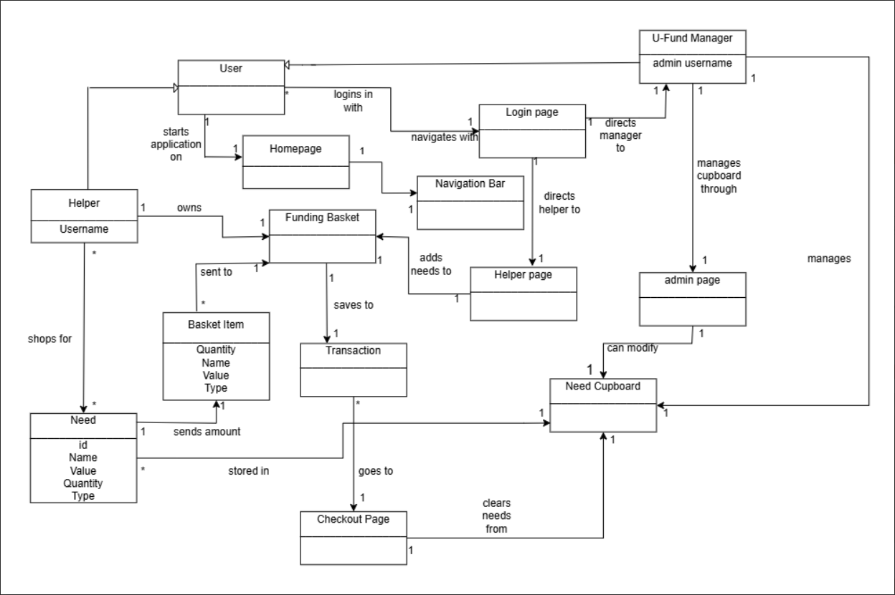

This is a domain model of a  small funding platform: a User (assisted by an AI that answers need-related questions) interacts with two roles—Helper (username/password) and U-Fund Manager (admin credentials). Helpers can create reviews (username, rating) about the website, owns a funding basket, and shops for needs. A Funding Basket holds multiple basket items (quantity, name, value, type) that send amounts toward specific needs (id, name, value, quantity, type). Baskets produce transactions that update the need cupboard, where needs are stored; the U-Fund Manager manages the cupboard and can delete reviews. Overall flow: Helper → Basket → Basket Items → Transaction → Need/Need Cupboard, with governance by the U-Fund Manager and guidance from the AI for users.

## Architecture and Design
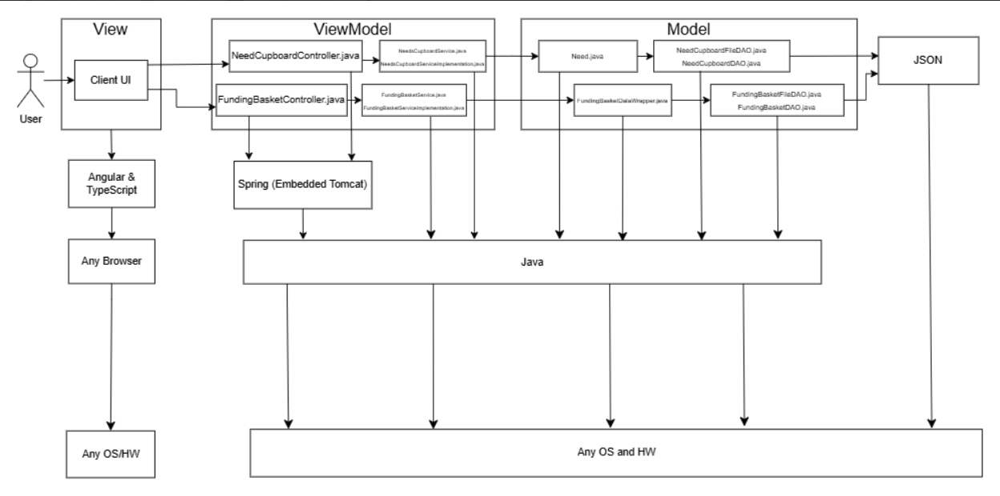

This section describes the application architecture.

### Summary
The front end is Angular and TypeScript that runs in any browser. The back end is a Spring Boot server written in Java. Data is saved in JSON files on storage.

In the View box is the client UI. It shows pages and buttons. When the user clicks something, the browser sends an HTTP request and expects JSON back.

The ViewModel box is the API and service layer. Controllers like NeedCupboardController.java and FundingBasketController.java define the URLs. They call services such as NeedCupboardService and FundingBasketService that hold the business rules. The “Implementation” classes are the concrete service code that runs.

The Model box is about data and storage. Domain classes like Need.java and FundingBasketDataWrapper.java describe what the data looks like. DAO interfaces (NeedCupboardDAO, FundingBasketDAO) define how to load and save that data. File DAO classes (NeedCupboardFileDAO.java, FundingBasketFileDAO.java) actually read and write the JSON files.

### Overview of User Interface
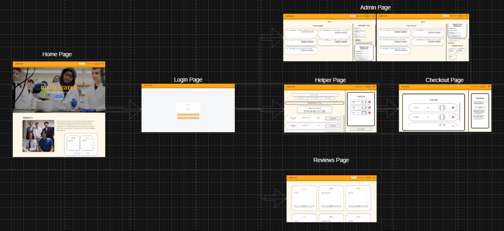

The primary flow is present on the Need Page and Checkout Page.

The Need Page has a split layout where the left panel lists all available needs in the “need cupboard,” and the right panel shows the user’s current “funding basket.” Users can add items from the cupboard to their basket and adjust their quantities.

Proceeding to the Checkout Page, the user sees a similar layout with basket contents on the left and payment inputs on the right.
Filling out the payment fields and clicking checkout submits the purchase which makes the system remove the purchased quantities from the need cupboard, clears the user’s basket.

The admin flow is as follows:
If a user logs in with the username “admin,” they’re taken to the Admin Page, which has a similar split layout with the left side displaying the current contents of the need cupboard, while the right side provides fields to add, update, or remove needs.
In addition, in the bottom right corner the current list of users are displayed. Here, the admin can delete specified users.

Additional elements:
In the home-page, any logged-in user will see a section dedicated to showcasing two randomly selected reviews. Underneath, there is a button to re-select two random reviews

When logged in, any user can navigate to the reviews page from the navigation bar. Here, non-admins have a field to create a review given the rating and description. Admins have the ability to delete any individual review.

*** 

***

### View Tier

__Angular components: (components will be referred to by their folder name, ie. helper-page, modal-host, nav-bar...)__

We have four main components that the handle routing and pop-ups on each page: home-page, checkout-page, helper-page, and login-page components.
  - These components, alongside our nav-bar, directly route users to other areas of the website. 

Our nav-bar component is placed in the top-line of our page .html files so that it is consistent across the website. 

The admin-page does not have any routing because the admin does not have other sections they need to look into apart from the reviews page, which has a button to navigate to it in the nav-bar component. 
- It contains a field to modify the needs in the needs cupboard. Being able to delete, update, or add new ones. 
- It contains a field to modify the donation goal, increasing or decreasing how much money the admin would like to display. 
- It contains a field to view all users and also delete them by name. However, admins are unable to delete other admins (in this case, the admin cannot delete themselves).

The review-page does not have any routing because access to the page is handled in the nav-bar and the page itself does not need to route to other pages.
- It contains a list of all the reviews formatted as cards with a number of gold stars to indicate a review's rating for the user to view.
- It also contains a field to create a review given a rating and description. Each review is created by a user and is not anonymous. 

__Within these pages are the components that manage our front-end logic.__

The needs-cupboard and funding-basket components house and modify their respective user's needs:
- The funding-basket component is present in both the helper-page and checkout-page to display and modify the current-users needs in their funding basket. 
  - It contains options to increase or decrease the quantity of a need, or completely delete a need from the user's basket.
- The needs-cupboard component is only present in the helper-page.
  - It contains the option to add an item to the funding basket. 
  - In addition, the needs have colored progress bars that are orange when not filled, and green when the need is met/is in surplus.

The checkout component is present in the checkout-page.
- It contains a button to checkout the user's funding basket. 
- It also displays the total cart value and any needs that have already been met in the cupboard.

The modal-host component is present throughout all our application within various components. 
- It is a framework for pop-ups with modifiable text.

The reviews-card component is present in the home page.
- It displays two random reviews.
- It contains a button to refresh the two reviews to two random reviews. (there will not be two of the same review displayed at the same time)
- It contains a button to navigate to the review-page

The ai component is present in the nav-bar, and thus shared across all pages with a nav-bar.
- ai handles our AI chatbot P.H.I.L., containing prompt input, the chatbot's output, and a button to toggle the ai's visibility.

__Services:__
  - Each of these components have an associating service denoted by similar names. Each component contains one or more of the services that are needed.
  - The admin-page-service, ai-service, funding-basket-service, needs-cupboard-service, donation(donation service) and review-service connect the front-end to the API through http requests. 
  - The modal-service contains user input logic for the modal-host component
  
***

__Sequences:__

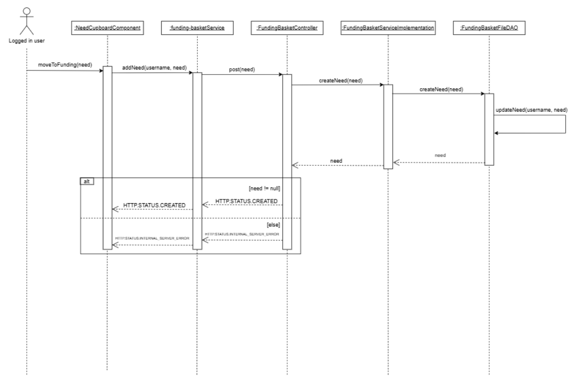

__Add Need from Cupboard to Funding Basket:__
On the helper-page, the user clicks the "Add to Cart" or "Donate Extra" button (the button displays different text depending on the need's surplus status, but same logic) in the needs-cupboard that sends a request to the funding-basket-service that then sends a request to the API, which after more requests within the API, returns the status of success or an error. When a success status is received, sends a broadcast to the rest of the application notifying that the needs have been updated.

__Checkout a need:__
On the checkout-page, in the checkout component, the user clicks "Checkout" button that first checks every need in the funding basket, calculates the total of the basket, and calls the donation (service) to update the total donation count based on that calculation. The donation (service) then sends an http request to the DonationController in the API, which then returns the resulting Donation of the update to the front end. Then, for each need in the use's funding basket, the checkout component finds the matching need in the need cupboard and modifies its current quantity. Afterwards, the component sends a broadcast to the rest of the application notifying that the needs have been updated, and then routes to the helper-page. 

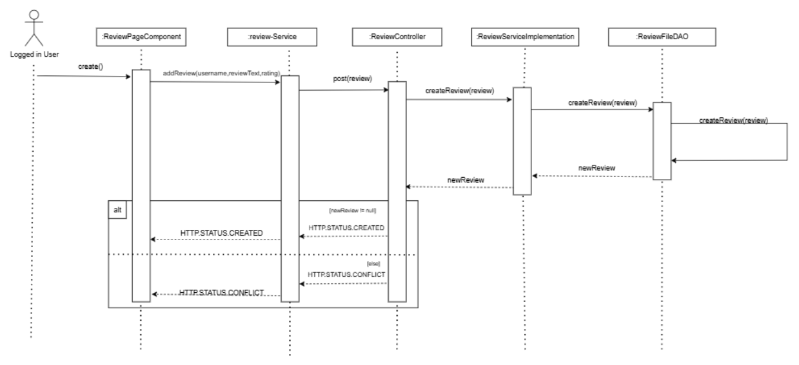

__Create Review:__
On the review-page, the user fills in the Create Review card located on the top of the page. After filling in the information and clicking "Create Review", the component calls the review-service to add a review, which then sends an http request to the ReviewController in the API, which after more requests sent within the API, returns the status of success or an error. The front-end then sends a broadcast to the rest of the application notifying that the reviews have been updated. This currently only is checked by the home-page, which refreshes the displayed reviews if one of the displays was the target for deletion. 

__Prompt AI Chatbot, P.H.I.L.:__
On any page, with the ai tab toggled open, the user fills in the "Enter Prompt" text area. After filling in the information and clicking "Get Response", the component calls the ai-service to create a response. The service then sends a http request to the GeminiAPIController in the api, which further sends requests to other aspects of the API, and then to the Gemini API that returns the response, which is then returned back up to the front end and displayed in the textbox. 

***

***

### ViewModel Tier

* NeedsCupboardController.java - Handles HTTP requests from the model tier for the Needs cupboard. 
  * getNeed()
      * Handles HTTP GET requests to the "/needs/id"
      * @param id: the searched objects id
      * @return a Response entity containing HttpStatus.OK if the search was successful,
      * a HttpStatus.NO_CONTENT if the returned data is null
      *  HttpStatus.INTERNAL_SERVER_ERROR if an I/O error occurred.
      * Retrieves a specified need given an id.
  * getNeeds()
      * Handles HTTP GET requests to the "/needs"
      * @return a Response entity containing HttpStatus.OK if the array of needs is returned,
      * a HttpStatus.NO_CONTENT if the return fails
      * HttpStatus.INTERNAL_SERVER_ERROR if an I/O error occurred.
      * Retrieves all needs in the NeedCupboard
  * searchNeeds()
      * Handles HTTP GET requests to the "/needs/?name= "name""
      * @param name , check if need contains String name
      * @return a Response entity containing HttpStatus.OK if the search was successful,
      * HttpStatus.INTERNAL_SERVER_ERROR if an I/O error occurred.
      * Searches for needs containing the given text
  * createNeed()
      * Handles HTTP POST requests to the "/needs"
      * @param need: the object to be created
      * @return a Response entity containing HttpStatus.CREATED if the creation was successful,
      * a HttpStatus.CONFLICT if the creation fails due to a conflict, or a HttpStatus.INTERNAL_SERVER_ERROR
      * if an I/O error occurred.
      * Creates a need given its (name, value, quantity, and type). An id is automatically generated. 
  * updateNeed()
      * Handles HTTP PUT requests to the "/needs"
      * @param need: the object to be updated
      * @return a Response entity containing HttpStatus.OK if the update was successful,
      * a HttpStatus.NOT_FOUND if need doesn't exist
      * HttpStatus.INTERNAL_SERVER_ERROR if an I/O error occurred.
      * Updates a need given its (id, name, value, quantity, and type). It will update the data at the specified id.
  * updateNeedVisibility()
      * Handles HTTP PUT requests to the "/needs/visibile/"visible""
      * @param userName: the user to update
      * @param id: the id of the need to be updated
      * @param visible: the visibility state to set the need
      * @return a Response entity containing HttpStatus.OK if the update was successful,
      * a HttpStatus.NOT_FOUND if need doesn't exist
      * HttpStatus.INTERNAL_SERVER_ERROR if an I/O error occured.
      * Updates a need's (visibile) attribute to true/false
  * deleteNeed()
      * Handles HTTP DELETE requests to the "/needs"
      * @param id , id of need to be deleted
      * @return a Response entity containing HttpStatus.OK if the deletion was successful,
      * a HttpStatus.NOT_FOUND if a need of id doesn't exist
      * HttpStatus.INTERNAL_SERVER_ERROR if an I/O error occurred.
      * Deletes a need given its id. 
  * deleteNeedType()
      * Handles HTTP DELETE requests to the "/needs"
      * @param type , type of need to be deleted
      * @return a Response entity containing HttpStatus.OK if the deletionn was successful,
      * a HttpStatus.NOT_FOUND if a need of id doesn't exist
      * HttpStatus.INTERNAL_SERVER_ERROR if an I/O error occured. 
      * Deletes a need given it contains the given type.
  * deleteAll()
      * Handles HTTP DELETE requests to the "/needs"
      * @return a Response entity containing HttpStatus.OK if the deletionn was successful,
      * a HttpStatus.NOT_FOUND if a need of id doesn't exist
      * HttpStatus.INTERNAL_SERVER_ERROR if an I/O error occured.
      * Deletes all needs in the Cupboard. 
  * deleteNeedName()
      * Handles HTTP DELETE requests to the "/needs"
      * @param name , string to check if name contains
      * @return a Response entity containing HttpStatus.OK if the deletion was successful,
      * a HttpStatus.NOT_FOUND if a need of id doesn't exist
      * HttpStatus.INTERNAL_SERVER_ERROR if an I/O error occured. 
      * Deletes needs given it contains the specified name.
    
* FundingBasketController.java - Handles HTTP requests from the model tier for the Funding Basket.
  * getUsers()
      * Handles HTTP GET requests to "/funding_basket_needs/users"
      * @return a Response entity containing HttpStatus.OK if the array of users is returned,
      * a HttpStatus.NO_CONTENT if the returned data is null
      * HttpStatus.INTERNAL_SERVER_ERROR if an I/O error occured.
  * getUsernames()
      * Handles HTTP GET requests to "/funding_basket_needs/usernames"
      * @return a Response entity containing HttpStatus.OK if the array of users is returned,
      * a HttpStatus.NO_CONTENT if the returned data is null
      * HttpStatus.INTERNAL_SERVER_ERROR if an I/O error occured. 
  * getNeed()
      * Handles HTTP GET requests to "/funding_basket_needs/userName/id"
      * @param userName: the user to search in
      * @param id: the searched objects id
      * @return a Response entity containing HttpStatus.OK if the search was successful,
      * a HttpStatus.NOT_FOUND if the search fails due to a non existent id
      *  HttpStatus.INTERNAL_SERVER_ERROR if an I/O error occured. 
  * getNeeds()
      * Handles HTTP GET requests to "/funding_basket_needs/userName/needs"
      * @param userName: the user to retrieve from
      * @return a Response entity containing HttpStatus.OK if the array of needs is returned,
      * a HttpStatus.NO_CONTENT if the returned data is null
      * HttpStatus.INTERNAL_SERVER_ERROR if an I/O error occured. 
  * searchNeeds()
      * Handles HTTP GET requests to "/funding_basket_needs/userName/?name= "name""
      * @param userName: the user to search from
      * @param name , check if need contains String name
      * @return a Response entity containing HttpStatus.OK if the search was successful,
      * HttpStatus.INTERNAL_SERVER_ERROR if an I/O error occured. 
  * createNeed()
      * Handles HTTP POST requests to "/funding_basket_needs/userName "need""
      * @param userName: the user to create in
      * @param need: the object to be created
      * @return a Response entity containing HttpStatus.CREATED if the creation was successful,
      * a HttpStatus.CONFLICT if the creation fails due to a conflict, or a HttpStatus.INTERNAL_SERVER_ERROR
      * if an I/O error occured. 
  * updateNeed()
      * Handles HTTP PUT requests to "/funding_basket_needs/userName "need""
      * @param userName: the user to update
      * @param need: the object to be updated
      * @return a Response entity containing HttpStatus.OK if the update was successful,
      * a HttpStatus.NOT_FOUND if need doesn't exist
      * HttpStatus.INTERNAL_SERVER_ERROR if an I/O error occured. 
  * updateNeedVisibility()
      * Handles HTTP PUT requests to "/funding_basket_needs/userName/id/visible/"visible""
      * @param userName: the user to update
      * @param id: the id of the need to be updated
      * @param visible: the visibility state to set the need
      * @return a Response entity containing HttpStatus.OK if the update was successful,
      * a HttpStatus.NOT_FOUND if need doesn't exist
      * HttpStatus.INTERNAL_SERVER_ERROR if an I/O error occured. 
  * deleteNeedId()
      * Handles HTTP DELETE requests to "/funding_basket_needs/userName/id"
      * @param userName: the user to delete from
      * @param id , id of need to be deleted
      * @return a Response entity containing HttpStatus.OK if the deletionn was successful,
      * a HttpStatus.NOT_FOUND if a need of id doesn't exist
      * HttpStatus.INTERNAL_SERVER_ERROR if an I/O error occured.
  * deleteNeedType()
      * Handles HTTP DELETE requests to "/funding_basket_needs/userName/type/type"
      * @param userName: the user to delete from
      * @param type , type of need to be deleted
      * @return a Response entity containing HttpStatus.OK if the deletionn was successful,
      * a HttpStatus.NOT_FOUND if a need of id doesn't exist
      * HttpStatus.INTERNAL_SERVER_ERROR if an I/O error occured. 
  * deleteAll()
      * Handles HTTP DELETE requests to "/funding_basket_needs/userName"
      * @param userName: the user to delete from
      * @return a Response entity containing HttpStatus.OK if the deletionn was successful,
      * a HttpStatus.NOT_FOUND if a need of id doesn't exist
      * HttpStatus.INTERNAL_SERVER_ERROR if an I/O error occured. 
  * deleteNeedName()
      * Handles HTTP DELETE requests to "/funding_basket_needs/name/"name""
      * @param userName: the user to delete from
      * @param name , string to check if name contains
      * @return a Response entity containing HttpStatus.OK if the deletionn was successful,
      * a HttpStatus.NOT_FOUND if a need of id doesn't exist
      * HttpStatus.INTERNAL_SERVER_ERROR if an I/O error occured.
   
* ReviewController.java - Handles HTTP requests for reviews
  * getReviews()
      * Handles HTTP GET requests to "/reviews"
      * @return a Response entity containing HttpStatus.OK if the array of reviews is successfully returned,
      * an HttpStatus.NO_CONTENT if there are no reviews
      * an HttpStatus.INTERNAL_SERVER_ERROR if an I/O error occured
  * getReviewsByRating()
      * Handles HTTP GET requests to "/reviews/rating/{rating}"
      * @param rating: the rating value the reviews are filtered by
      * @return a Response entity containing HttpStatus.OK if reviews with matching ratings are found
      * a HttpStatus.NO_CONTENT if no reviews match the rating parameter
      * HttpStatus.INTERNAL_SERVER_ERROR if an I/O error occurs
  * createReview()
      * Handles HTTP POST requests to "/reviews"
      * @param review: the Review object to be created
      * @return a Response entity containing HttpStatus.CREATED if the review is successfully created,
      * HttpStatus.CONFLICT if the creation failed,
      * HttpStatus.INTERNAL_SERVER_ERROR if an I/O error occured
  * deleteReview()
      * Handles HTTP DELETE requests to "/reviews/{id}"
      * @param id: the id of the review that is being deleted
      * @return a Response entity containing HttpStatus.OK if the review was deleted successfully,
      * HttpStatus.NOT_FOUND if there is no review with the given id
      * HttpStatus.INTERNAL_SERVER_ERROR if an I/O error occurred
  * deleteReviewsByUsername()
      * Handles HTTP DELETE requests to "/reviews/user/{userName}"
      * @param userName: the username of the user whose reviews should be deleted
      * @return a Response entity containing HttpStatus.ok if the review was deleted successfully,
      * HttpStatus.NOT_FOUND if there are no reviews from the given userName
      * HttpStatus.INTERNAL_SERVER_ERROR if an I/O error occurs
  * deleteAllReviews()
      * Handles HTTP DELETE requests to "/reviews"
      * @return a Response entity contatin HttpStatus.OK if all the reviews were deleted successfully,
      * HttpStatus.NOT_FOUND if there are no reviews
      * HttpStatus.INTERNAL_SERVER_ERROR if an I/O error occurs. 

* GeminiAPIController.java - Handles requests to API from model tier to generate a response
  * getGeminiResponse()
    * Get the API’s response for given prompt
    * @param prompt, user-provided prompt
    * @ return, ResponseEntity<APIResponse> containing the response or error message

* AccountController.java - Handles HTTP requests for account management
  * getAccounts()
    * Handles HTTP GET requests to "/accounts"
    * @return a ResponseEntity containing HttpStatus.OK with the array of accounts
    * HttpStatus.NO_CONTENT if the returned data is null,
    * or HttpStatus.INTERNAL_SERVER_ERROR if an I/O error occurred.
  * getUsernames()
    * Handles HTTP GET requests to "/accounts/usernames"
    * @return a ResponseEntity containing HttpStatus.OK with the array of usernames,
    * HttpStatus.NO_CONTENT if the returned data is null,
    * or HttpStatus.INTERNAL_SERVER_ERROR if an I/O error occurred.
  * exists()
    * Handles HTTP GET requests to "/accounts/exists/{username}"
    * @param username the username to check
    * @return a ResponseEntity containing HttpStatus.OK with true/false,
    * or HttpStatus.INTERNAL_SERVER_ERROR if an I/O error occurred.
  * create()
    * Handles HTTP POST requests to "/accounts"
    * @param account the Account to create
    * @return a ResponseEntity containing HttpStatus.CREATED if creation was successful,
    * HttpStatus.CONFLICT if the username already exists,
    * or HttpStatus.INTERNAL_SERVER_ERROR if an I/O error occurred.
  * login()
    * Handles HTTP POST requests to "/accounts/login"
    * @param req the Account object containing username and password
    * @return a ResponseEntity containing HttpStatus.OK if credentials are valid,
    * HttpStatus.UNAUTHORIZED if invalid,
    * or HttpStatus.INTERNAL_SERVER_ERROR if an I/O error occurred.
  * delete()
    * Handles HTTP DELETE requests to "/accounts/{username}"
    * @param username the username to delete
    * @return a ResponseEntity containing HttpStatus.OK if deletion was successful,
    * HttpStatus.NOT_FOUND if the username does not exist,
    * or HttpStatus.INTERNAL_SERVER_ERROR if an I/O error occurred.

* DonationController.java - Handles HTTP requests for Donation System
  * getStatus()
    * Get the current information in donations
    * @GetMapping
    * @param donationService
    * @return Status
    * @throws IOException
  * addDonation()
    * Increment the donations
    * @param amount
    * @return donation increment
    * @throws IOException
  * setGoal()
    * Update the donationGoal
    * @param newGoal
    * @return update goal
    * @throws IOException
    * @PostMapping

***

The ViewModel tier is the middle layer of the system. It exposes the REST API that the Angular front end calls and shields the UI from persistence details. Each feature follows the same structure: a controller that defines HTTP endpoints, a service interface that describes the business operations, and a concrete service implementation that delegates to the appropriate DAO in the Model tier.

For the core shopping flow, NeedsCupboardController and FundingBasketController provide endpoints for working with needs and funding baskets. NeedsCupboardController handles global operations on the shared cupboard of Need objects, passing work to NeedsCupboardService and NeedsCupboardServiceImplementation, which in turn call NeedsCupboardDAO. FundingBasketController manages per-user baskets (fetching, searching, updating, and clearing items) through FundingBasketService and FundingBasketServiceImplementation, which talk to FundingBasketDAO. Together these classes implement everything the Needs page and Checkout page require to move items between cupboard and basket and to keep user-specific state.

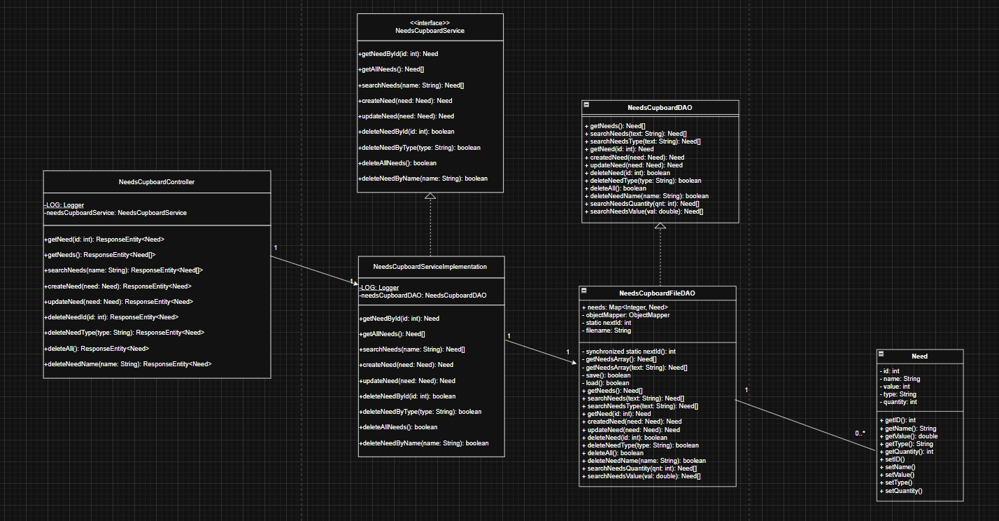
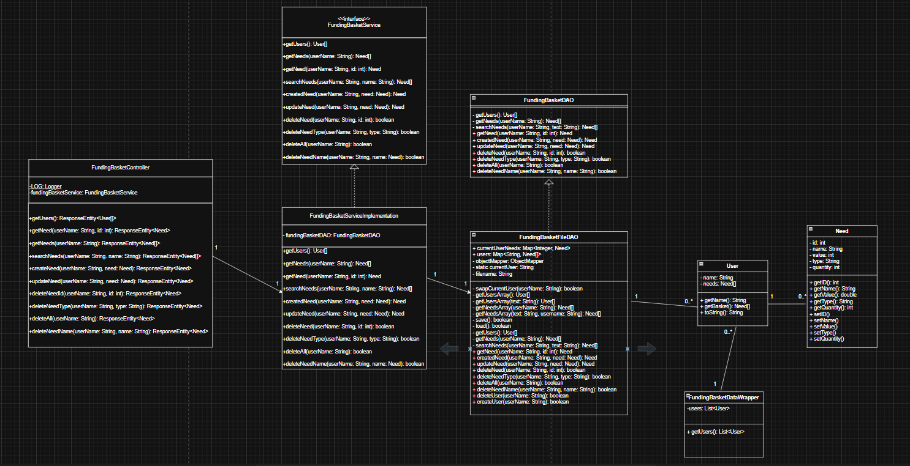

Account management uses the same pattern. AccountController exposes routes for listing accounts, getting usernames, checking if a username exists, creating accounts, logging in, and deleting accounts. It depends on AccountService and AccountServiceImplementation, which rely on AccountDAO and, when needed, coordinate with FundingBasketDAO so that user data stays consistent when accounts are removed. The review system mirrors this as well: ReviewController accepts requests to fetch, filter, create, and delete reviews, forwarding them to ReviewService and ReviewServiceImplementation, which operate on review data through ReviewDAO.

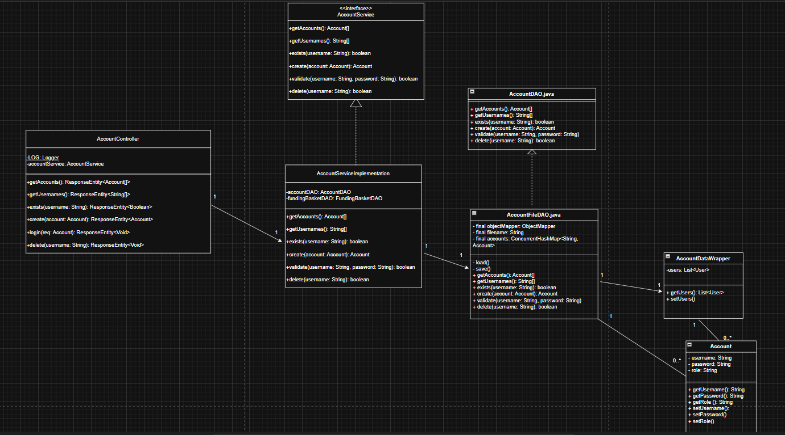

Enhancement features are also integrated into this tier. DonationController provides endpoints to read donation status, add new donations, and update the donation goal, delegating to DonationService and DonationServiceImplementation, which use DonationDAO for storage. GeminiAPIController offers an endpoint that takes a prompt and returns an AI-generated reply; it calls GeminiAPIService and GeminiAPIServiceImplementation, which wrap the Gemini client and use GeminiFileDAO to persist prompt response pairs as APIResponse objects. Overall, the ViewModel tier ties the Angular UI to the Model tier through a consistent controller–service–DAO pattern, covering needs, baskets, accounts, reviews, donations, and AI assistance.

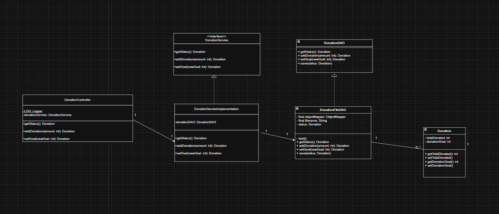
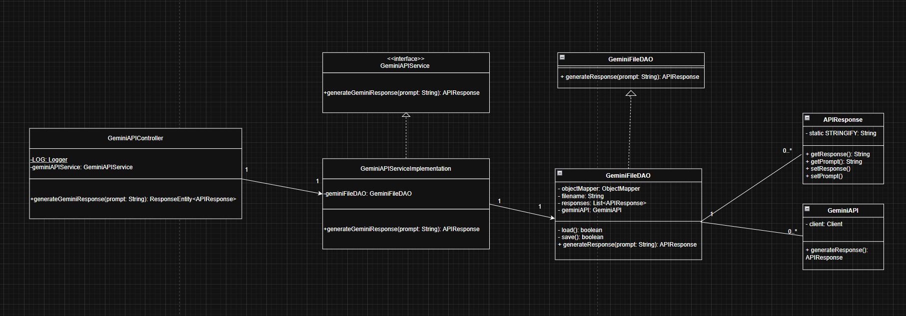

***

***

### Model Tier

Our Model tier consists of a Need.java file that contains our need object. Each need object has an identification (id), name, value (or the cost), type (what type of item it is), and quantity. There are getter and setters for each of the variables above.

Our Model tier also includes a User.java file that represents an individual user. Each user has a name and a funding basket (an array of needs). The class has a constructor to initialize these fields and getters (getName(), getBasket()). Finally, we also have a FundingBasketDataWrapper.java file that wraps the collection of users for persistence and transport. It holds a single field, a list of users, along with a constructor to set it and a getter (getUsers()).

Additionally, our Model tier contains a Review.java file that represents a review written by a user. Each review has an id, the username of the reviewer, the text content of the review, and an integer rating. The class contains a constructor to initialize the various fields and getters for each field including: getId(), getUserName(), getReviewText(), and getRating().

Also, the Model tier has an APIResponse.java, GeminiAPI.java, and GeminiAPIConfig.java. These files serve as the foundation for the user’s interaction with the AI chatbot. APIResponse.java is responsible for formatting the prompt/response pair for JSON storage. GeminiAPI is where the response is generated, and GeminiAPIConfig.java is responsible for declaring GeminiAPI as a Bean in the Spring Framework.

Finally, our Model tier has an Account.java and AccountDataWrapper.java. Account.java that represents each individual user account, with their username, password, and role. It has setters and getters for each as well (setUsername(), setPassword(), setRole(), getUsername(), getPassword(), getRole()). AccountDataWrapper.java, similar to FundingBasketDataWrapper.java, wraps the collection of users for persistence and transport. It holds a lists of users/accounts as well with a getter and setter (getUsers(), setUsers()).

  * Need.java - Create a Need object with given id, name, and value.
    * Contains getters (getID() -> int, getName() -> String, getValue() -> double, getQuantity() -> int, getType() -> String) and setters (setName(), setValue(), setQuantity(), setType()). Also contains a (toString() -> String) override.
    * This is used in NeedsCupboardFileDAO.java to hold data for a need/s.
  
  * FundingBasketDataWrapper.java - Create a Data Wrapper object with a given list of users (List<User>).
    * Contains (getUsers() -> List<User>) that returns the list of users.
    * The DataWrapper is used in FundingBasketFileDAO.java to wrap the data taken from funding_basket.json into a list of Users for proccessing by the application, and then later setting data proccessed by the application to the .json file.
  * User.java - Create a User object with a given name and basket(list of needs)
    * Contains getters (getName() -> String, getNeeds() -> Need[]) and a (toString() -> String) override.
    * This is used in FundingBasketFileDAO.java to hold data for a user/s.

  * NeedCupboardFileDAO.java - the working logic behind our application for accessing the Needs Cupboard. 
    * getNeedsArray()
      * @param text, if this string is passed in only add needs contaiting to Array
      * @return Array of Needs
      * Creates array of Needs from tree map for needs that contain "text".
      * if "text" is null, array will contain all needs in the treemap.
    * save()
      * Saves Needs from map into file
      *@return true, if written successfully
    * load()
      * Load from JSON into the map
      * Increment id after all have been read in
      * @return true if read successfully
    * getNeeds()
      * @return getNeedsArray
      * Returns an array of all needs in the JSON.
    * searchNeeds()
      * Search for needs containing text passed in
      * @param String text
      * @return getNeedsArray that contains text
    * getNeed()
      * Returns single need with id
      * @param int id id to search for 
      * @return need if found, null if no id in needs JSON
    * createNeed()
      * @param need: the input object containing the name, value, quantity, and type
      * @return the new need with a generated id
      * @throws I/O exception if an error occured while saving the new Need to storage
    * updateNeed()
      * Update need's contents, ie name, value, quantity, type
      * @param  Need need
      * @return Need updated need
    * deleteNeed()
      * Delete need at specified id
      * @param int id
      * @return true if file was updated succesfully
      * @return false, if deletion failed 
    * deleteNeedType()
      * Delete all needs of specific type
      * Seemed liike using a removeIf is the best way to do this 
      * since you cant iterate through a tree map and delete things without throwing error.
      * @param int id
      * @return true if file was updated succesfully
      * @return false, if deletion failed
    * deleteAll()
      * Delete all needs
      * @return true if file was updated succesfully
      * @return false, if deletion failed
    * deleteNeedName()
      * Delete all needs of specific name
      * @return true if file was updated succesfully
      * @return false, if deletion failed 

  * FundingBasketFileDAO.java - the working logic behind our application for accessing the Needs Cupboard. 
    * swapCurrentUser()
      * Swaps the current user to the specified userName, setting their respective data
      * @param userName the user that will be swapped to
      * @return
    * getUsersArray()
      *  Create array of Users from tree map
      * @return Array of Users, could be null 
    * getNeedsArray()
      *  Create array of Needs from tree map
      * @param userName the user this method will get the needs of
      * @return Array of Needs, could be null
    * save()
      * Saves Needs from map into file
      *@return true, if written successfully
    * load()
      * Load from JSON into the map
      * Increment through every user, adding their name and their funding basket to the TreeMap
      * @return true if read successfully
    * getUsers()
      * Returns array of all users
      * @return getNeedsArray
    * getNeeds()
      * Returns array of all needs for a specified user
      * @param userName the user this method will modify
      * @return getNeedsArray 
    * searchNeeds()
      * Search for needs containing text passed in
      * @param userName the user this method will modify
      * @param String text
      * @return getNeedsArray that contains text 
    * getNeed()
      * Returns single need with id
      * @param userName the user this method will modify
      * @param int id id to search for 
      * @return need if found, null if no id in needs JSON 
    * createNeed()
      * Creates a new Need object and a new User if one was not present
      * @param userName: the name of the user the new need belongs to
      * @param need: the input object containing the id, name, value, quantity, and type
      * @return the new need
      * @throws I/O exception if an error occured while saving the new Need to storage
    * updateNeed()
      * Update need's contents, ie name, value, quantity, type
      * @param userName the user this method will modify
      * @param  Need need
      * @return Need updated need
    * deleteNeed()
      * Delete need at specified id
      * @param userName the user this method will modify
      * @param int id
      * @return true if file was updated succesfully
      * @return false, if deletion failed
    * deleteNeedType()
      * Delete all needs of specific type
      * Seemed liike using a removeIf is the best way to do this 
      * since you cant iterate through a tree map and delete things without throwing error.
      * @param userName the user this method will modify
      * @param string type
      * @return true if file was updated succesfully
      * @return false, if deletion failed 
    * deleteAll()
      * Delete all needs
      * @param userName the user this method will modify
      * @return true if file was updated succesfully
      * @return false, if deletion failed 
    * deleteNeedName()
      * Delete all needs of specific name
      * @param userName the user this method will modify
      * @return true if file was updated succesfully
      * @return false, if deletion failed
        
  * Review.java
    * Creates a Review object using an id, userName, reviewText, and rating and parameters
    * Contains getters (getId() -> int, getUserName() -> String, getReviewText() -> String, getRating() -> int) as well as a (toString() -> String) override
    * This is used in ReviewFileDAO.java to hold data for reviews.
  
  * ReviewFileDAO.java - the working logic behind our application for accessing Reviews.
    * getReviews()
      * Loads all of the reviews from the persistance storage
      * @return an array of all reviews stored in the JSON file
    * getReviewsByRating
      * Filters the list of reviews to only show those that have the same rating as specified
      * @param int rating: the rating value to filter with
      * @return an array of reviews with the same rating as the parameter
    * createReview()
      * Adds a new review into the JSON file and assigns it a unique id.
      * @param Review review: the review object that is being added
      * @return the new Review now with an id
      * @throws I/O exception if an error ocurred
    * deleteReview()
      * Removes a review from the JSON based on its id
      * @param int id: the id of the review to delete
      * @return true if the review was deleted successfully or false if it was not
    * deleteReviewByUsername()
      * Removes all reviews from a specific user from the JSON
      * @param String userName: the username of the user whose reviews should be deleted
      * @return true if the review was deleted successfully or false if it was not
    * deleteAll()
      * Deletes all the reviews from the persistance storage
      * @return true if the file was updated successfully or false if it failed
    * save()
      * Write the current list of reviews into the JSON file
      * @return true if it was written successfully or false if it was not
    * load()  
      * Loads all the reviews from the JSON file into the memory
      * @return true if it read successfully

  * GeminiAPI.java - Use the Gemini API to interact with user
    * Contains:
      * generateResponse(String prompt) -> String — create a response from a prompt

  * GeminiAPIConfig.java - Initializes GeminiAPI.java as a Bean for the Spring framework
    * Contains:
      * genaiClient() -> Client — builds the client used in the API

  * APIResponse.java - Model for AI generated responses
    * Getters:
      * getResponse() -> String
      * getPrompt() -> String
    * Setters:
      * setResponse()
      * setPrompt()
    * Other:
      * toString() — string representation

  * GeminiFileDAO.java - the working logic behind getting API responses to user prompts
    * generateResponse()
      * Calls the API to generate a response from the prompt
      * @param prompt to generate the response with
      * @return APIResponse instance containing the prompt and its response
      * @throws IOException if error with generating the response
    * save()
      * Saves responses to file
      * @return true if written successfully
      * @throws IOException if write fails
    * load()
      * Loads responses from file
      * @return true if loaded successfully
      * @throws IOException if load fails

  * Account.java - Model for account creations
    * Getters:
      * getUsername() -> String
      * getPassword() -> String
      * getRole() -> String
    * Setters:
      * setUsername()
      * setPassword()
      * setRole()
    * Other:
      * toString()

  * AccountDataWrapper.java - Create a Data Wrapper object with a given list of users (List)
    * Contains:
      * getUsers() -> List — returns the list of users
      * setUsers() — sets a new list of users
    * Used in AccountFileDAO.java to wrap data from users.json into a List for processing and later write-back to the .json file

  * AccountFileDAO.java - the working logic behind our application for account management
    * load()
      * Load from JSON into the map
      * Iterates through every account, adding them to the hash map
      * @throws IOException if read fails
    * save()
      * Saves accounts from map into file
      * @return true, if written successfully
      * @throws IOException if write fails
    * getAccounts()
      * Returns array of all accounts
      * @return Account[] array of accounts (could be empty)
    * getUsernames()
      * Returns array of all usernames
      * @return String[] array of usernames (could be empty)
    * exists()
      * Checks if an account exists for the given username
      * @param username the username to check
      * @return true if the account exists, false otherwise
    * create(Account account)
      * Creates a new Account object; if the username already exists, returns null to indicate a conflict
      * @param account the input object containing the username, password, and role
      * @return the new Account if created; null if username already exists
      * @throws IOException if an error occurred while saving the new Account to storage
    * validate(String username, String password)
      * Validates credentials for an account
      * @param username the username to validate
      * @param password the password to validate
      * @return true if credentials are valid, false otherwise
    * delete(String username)
      * Deletes an account with the specified username
      * @return true if file was updated successfully, false if deletion failed or username not found
      * @throws IOException if an I/O error occurs while saving data

  * Donation.java - model behind Donation needs
    * getTotalDonated()
      * @return totalDonated
      * Returns the int value of the total amount that a user has donated
    * setTotalDonated(int totalDonated)
      * @param int totalDonated 
      * Allows the user to update the total donated amount
    * getDonationGoal()
      * @return int donationGoal
      * Getter for the value of donationGoal
    * setDonationGoal()
      * @param donationGoal
      * Allows for the setting of donationGoal

    * DonationDAO.java - working logic behind the functionality of the donation system
      * getStatus() 
        * Get current status of the json file behind the Donations
        * Returns a Donation object with the correct totalDonated and donationGoal
      * addDonation()
        * @param amount 
        * @return Donation
        * Increment donation by passed in amount parameter
      * setGoal()
        * @param newGoal
        * @return Donation
        * Setter for updating the goal in business logic
      * save()
        * @param Donation status
        * Save updated information to file

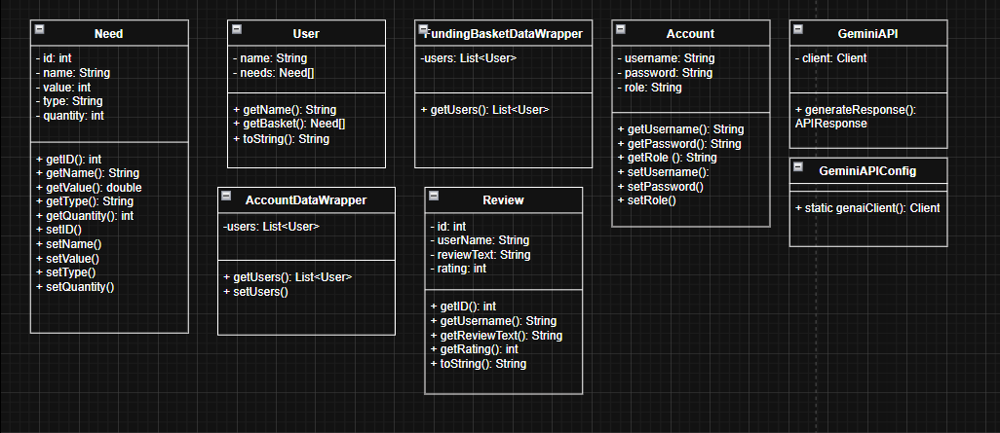
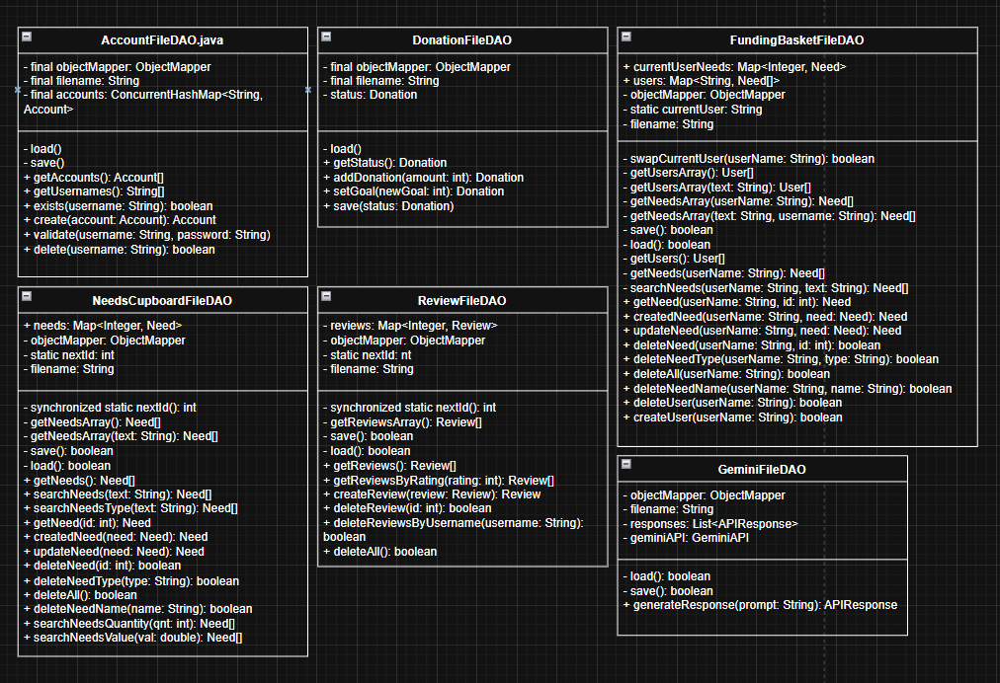

***

***

## OO Design Principles
Sprint 1: The two Object Oriented Design principles that the CTRL team is championing throughout the design and implementation are Low Coupling and Open/Close. The Low Coupling principle is aimed towards minimizing interdependence between different classes.  One example of Low Coupling in our project can be shown through our Need and User model classes. 

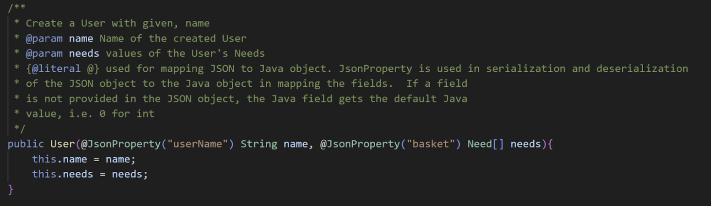

The need class only takes in primitive types as variables, which means that it has no reliance on other classes allowing it to follow the Low Coupling principle. The user class does take an array of needs as one of its variables, however, it is not dependent on the actual internal functions of the need class. This enables changes to be made to need without causing any problems with the User class. The open/closed object oriented principle states that software entities should be open for extension but closed for modification. One way this was utilized throughout the project was through the use of interfaces in the persistence tier. A specific example of this is shown below through NeedsCupboardDAO and NeedsCupboardFileDAO. 

As a result of the persistence tier being designed this way, if something such as how the data is stored is modified, the rest of the system will remain unaffected following the open/closed principle. 

Sprint 2: The two Object Oriented Design principles that the CTRL team is championing throughout Sprint 2 are the Law of Demeter and Pure Fabrication. The Law of Demeter principle is being followed through our implementation of service classes, which serves as an inbetween for the controller and DAO. This prevents the classes from having to call other classes that are distant which would break the “don’t talk to strangers” principle for the Law of Demeter. This can be shown through NeedsCupboardServiceImplementation and how it only talks to its DAO. 

Another principle that the service files helped us follow was Pure Fabrication. Pure Fabrication is when a new class is created to handle responsibilities that don’t fit well with the already existing classes. The service files were created to specifically handle the communication between the controller and DAO, making it a good example of following the Pure Fabrication principle. The searchNeedsType method in the NeedsCupboardServiceImplementation shows how the class functions as a middleman between the DAO and the controller, following the Pure Fabrication Principle. 

Sprint 3: The Object Oriented Design Principle that the CTRL team decided to champion throughout sprint 3 was Single Responsibility. The Single Responsibility principle is the idea that each class should have a single tightly focused responsibility. One way this principle was implemented throughout the project during sprint 3 was through the review system, where each class has its own specific purpose. In the model tier, the review model serves to define the structure of the reviews data. This can be seen through the constructor in the review model. 

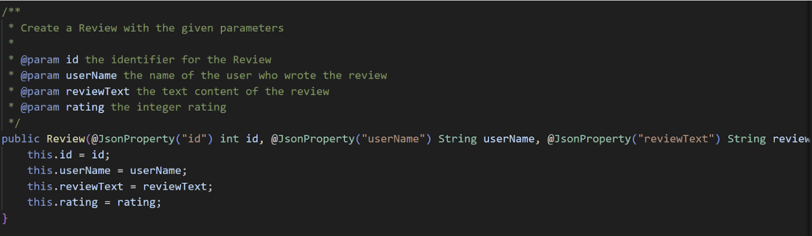

In the persistence tier, ReviewFileDAO handles the storage and retrieval of data for Reviews. Two methods that play a huge role in the storage and retrieval of data for Reviews are save() and load() methods that are shown below.

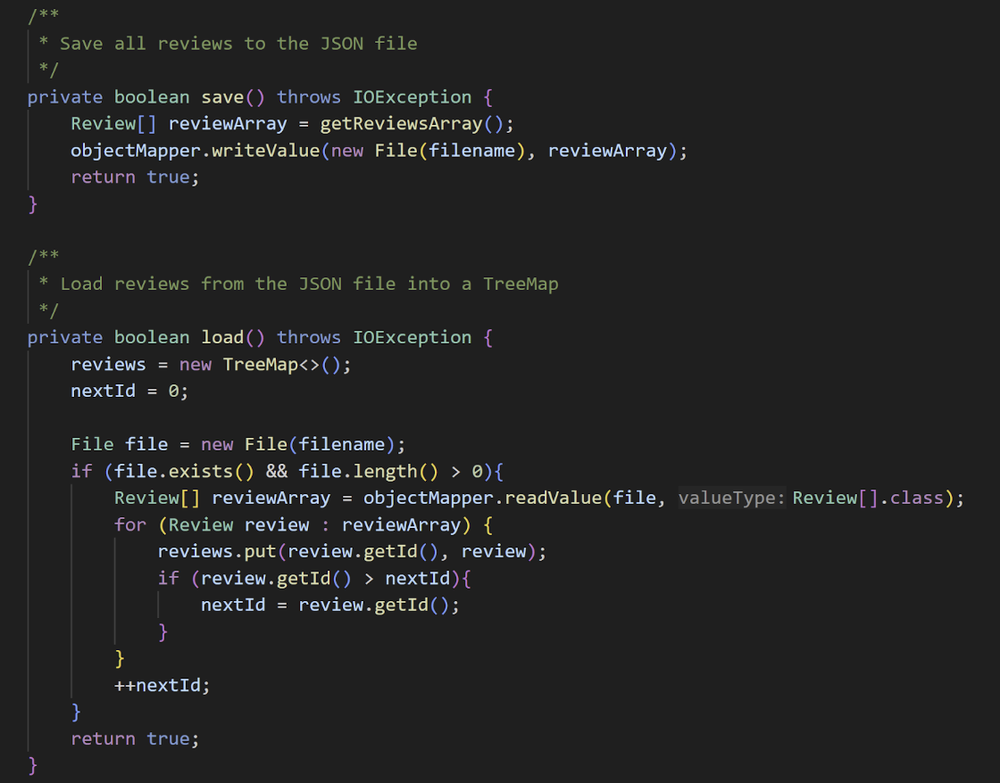

The ReviewServiceImplementation file handles all communications between the Review Controller and the Review Persistence tiers. This communication to the ReviewDAO can be seen in the code snippet below from ReviewServiceImplementation. 

Finally, the Review Controller handles all REST API requests for reviews. For example, the code below shows how the Review Controller handles the request for creating a new review.

Sprint 4: The Object Oriented Design Principle that the CTRL team decided to champion in sprint 4 is the dependency inversion principle. The dependency inversion principle states that high level modules should not be dependent on low level modules and that abstractions should not depend on concrete implementations. The dependency inversion principle can be demonstrated by our needs cupboard across all four tiers. Starting with the NeedsCupboardController in the controller tier, the controller utilizes NeedsCupboardService which is the interface for the service. This means that the NeedsCupboardController is not dependent on the DAO, rather is is dependent on the abstraction of the service. This follows the first part of the dependency inversion principle that states high level modules should not be dependent on low level modules. The implementation of NeedsCupboardService in the NeedsCupboardController file can be seen in the image below.

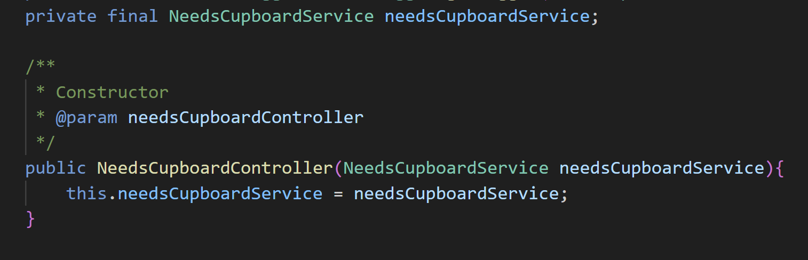

Similarly, the service tier does not depend on the NeedsCupboardFileDAO's concrete implementation. Instead, it utilizes the interface NeedsCupboardDAO which is independent of the actual storage of data. This follows the dependency inversion principle as high level logic is dependent on the abstraction rather than the concrete implementation. One example from NeedsCupboardServiceImplemenation is the updateNeed method which is shown below. The updateNeed method is not dependent on how NeedsCupboardDAO handles updateNeed, only that the DAO does handle it. 

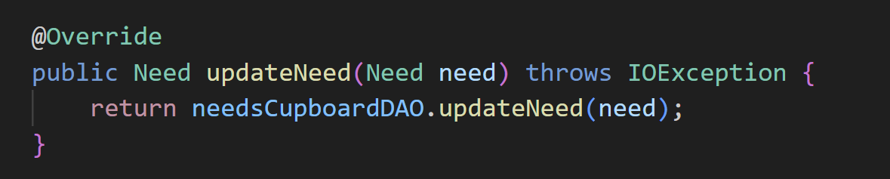

NeedsCupboardFileDAO in the persistance tier follows the dependency inversion principle by not being dependent on the controller or service tiers and only depending on the Need model. The Need model file is considered a domain abstraction which means that the persistance tier is only dependent on abstractions and not higher level logic. This is shown below in how the code only utilizes the Need model file and not any of the files from the controller or service files. 

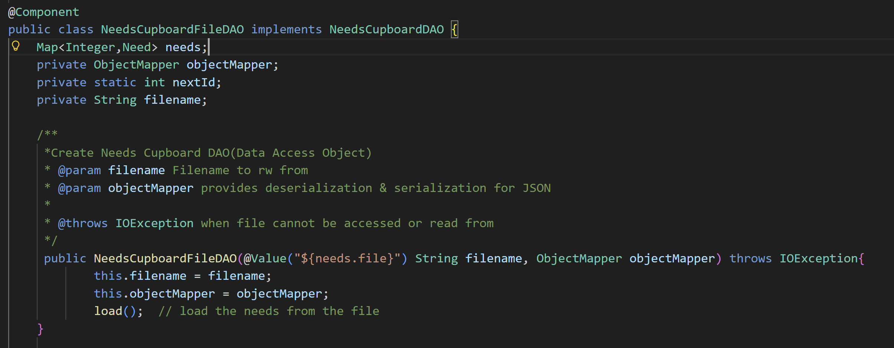

Finally, as stated above the Need model file is a domain abstraction that is not dependent on any of the other higher level modules. This can be demonstrated by the Need constructor where no higher level files are used, proving that the Need model file and by extension the rest of the NeedsCupboard system follows the dependency inversion principle. 

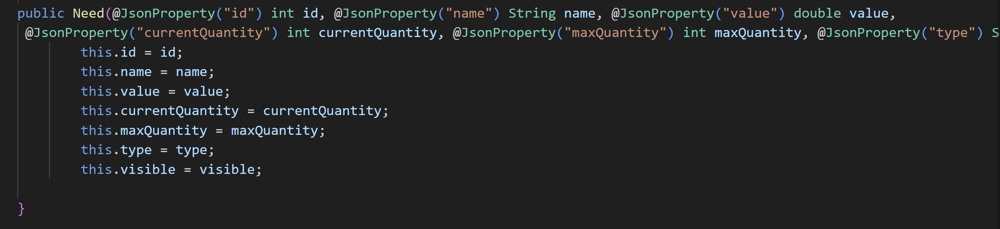

***

***

## Static Code Analysis/Future Design Improvements
Our code analysis proved helpful in highlighting key flaws in our design. Through the use of both SonarQube and SonarScanner we were able to get both numeric values that showed our coverage as well as key insight as to what in our code raises alarm. This allows the team to retrospectively improve on fields of our code that had issues.

Issue 1 : 
One of the biggest issues found in the code analysis was a security flaw in our AI enhancement. Our analysis recommended that we secure or remove the product key, this is due to the fact that this would prevent unauthorized use if found or data breaches. If we were to continue improving our design we would plan on encapsulating  this vital information like the API keys and user data so that our site would be safe for all users.

Issue 2 : 

Another issue that was flagged a lot was our CSS. We had many depreciated or unusable commands that caused numerous flags that should have been fixed during coding. If we had more time we think it would be smart to go back through all of our CSS and remove any lines of code that proved to be unusable. In doing so we could also clean up the code analysis so that more important flaws can be highlighted and easily recognized.

Issue 3 : 
In both our front and back end we had a lot of nested code that could cause both confusion for the reader and allow more gateways for miscoverage and increased cognitive complexity. As seen in the screenshot below of a function that has 2 nested for loops and many if statements.

If we had more time we would find it beneficial to refactor the code in such a way that conforms to good code writing practices. Such as creating a helper function that can replace the position of long nested calls.

***

## Testing
### Acceptance Testing
Across Sprint 2, acceptance testing indicates that the majority of user stories have fully met their acceptance criteria. Core user flows behaving as expected like the persistent navigation bar correctly routes to myResearch (Homepage), Login, and Checkout; the Login Page accurately authenticates valid users and their roles; and the needs list currently sending data to the funding basket. One acceptance criteria failure (which was later resolved) was where the wrong user’s funding basket appeared after login. Another acceptance criteria failure that was fixed was the Update Need feature on the Admin Page which attempts to modify an existing need, currently reset fields to empty or zero and does not save updates. Other than that, all other tested stories passed without exception. 

For sprint three, our acceptance testing has been nearly fully passed. The fails came in the form of two features we did not end up implementing. One was implementing designated types, which restricted the types the admin could enter to be a set list. The other is deleting reviews by username and filtering reviews by rating. We did not get to them due to the time constraints alongside other workloads, but realistically we could get them done in a good week of dedicated work.

***

### Unit Testing and Code Coverage
Our final code coverage achieved across all tiers of the ufund-api was 97%. Specifically, the Persistance tier had 96% coverage, the Controller tier had 97% coverage, the model tier had 96% coverage, and the service tier has 98% coverage. Our coverage target for each tier was 95% with the goal of each specific file element having at least 90% coverage. These values were selected to ensure we had strong, functional code across all tiers and files. Additionally, we chose to set the coverage targets that high to ensure that each method has at least some form of testing so nothing falls through and gets missed. Overall, our code coverage reached the target in every case except for the gemini ai chatbot files in the controller and model tiers. This was largely a result of the AI being one of the last things to be completed before the end of the sprint. Despite those two files falling short of the 90% target, the model and controller tiers still surpassed the 95% coverage goal for tiers.

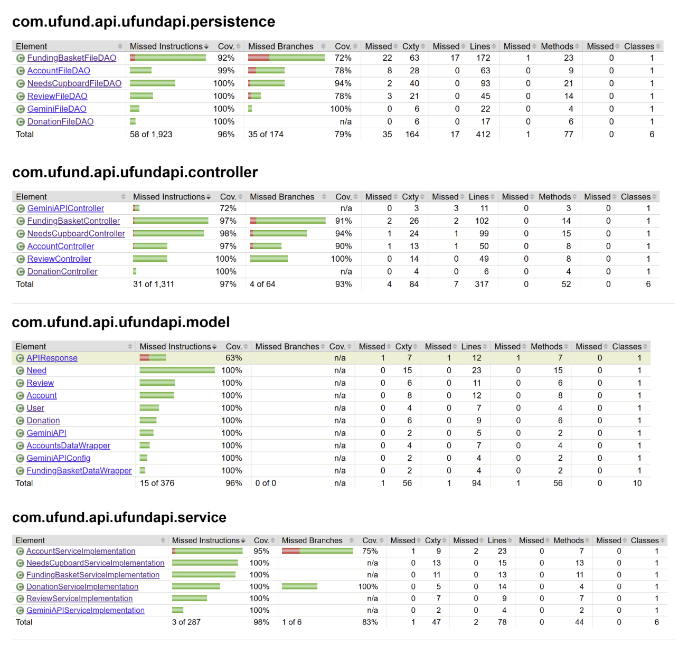

***

***

## Ongoing Rationale

* Sprint #1:
* 2025/09/10
  * Revised our Sprint 1 Domain Model with additional information on any “flavoring” we intend on adding.
  * Chose our project topic - “Research Funding : Name : RIT Student Funding Research”
* 2025/09/13
  * Trello updates that enforce our Sprint 1 Planning decisions and guidelines including: making a new list containing our plans in code communications, team communications, version control activities, and more. 
  * Also began initial drafts on acceptance criteria for each of our user stories.
* 2025/09/17
  * Assign OO Design Principles to each group member and champion two of them.
  * Understand how each user story can be implemented and coded as well as a general understanding of our project’s architecture. 
  * This includes beginning our draft of solution tasks for each user story.
* 2025/09/20
  * Finalize solution tasks and anything inside our user story cards.
  * Designed a UML of our classes and project structure to enforce our understanding of our project.
* 2025/09/24
  * Make sure each group member has an understanding of how our github works and begin coding each of our user stories.
* 2025/09/27-28
  * Finalize our Sprint 1 coding and make sure it adheres to our user story. 
  * Ensuring each member has their code properly working before merging all of it.
  * Record our demo video and our scripts.
  * Finish all Sprint 1 requirements in the Design Doc. 
 
* Sprint #2:

* 2025/10/01
  * Wrote our beginning sprint 2 epics and user stories
    * Assigned points to them with Planning Poker
    * Acceptance Test Plan updated with them
* 2025/10/04-05
  * Unit test verifications for MVC
    * Making sure they all ran + worked
  * Created our first angular files
    * Gave us a good baseline to work on
    * Split the stories among team members to work individually so we can test angular in our own playgrounds.
* 2025/10/08
  * Merged all our separate branches into main to create a beginning working UI (no functionality, just page routing)
  * Also added a navigation bar
* 2025/10/09
  * Completed code coverage of the unit tests we had
  * Assigned tasks of each of our user stories to begin having a UI with functionality
* 2025/10/13
  * Quick agenda and progress check on all our code.
  * Code reviewed one of our codes.

* 2025/10/18-19
  * Planned the our agenda for the rest of Spring 2 (establishing deadlines and work)
  * Began merging our almost final codes.
  * TODO : Currently have hardcoded that any password passes for users, this will be updated during sprint 3 if necessary.

* Sprint #3:

* 10/30/2025
  * Created new user stories and finalize 10& enhancements(Reviews, AI chatbot, and donations by $)
  * Planning poker to assign numeric values of difficulty to our user stories.
  * Assign user stories to team members and assign intermediate deadlines for features.

* 11/02/2025
  * Created sequence diagram for checkout flow.
  * Set weekly goals for UI, designated type, chatbot, search functionality, and backend implementation to fix known errors and implement back end for donations by money, AI, and reviews.

* 11/04/2025
  * Reviewed feedback from sprint 2 and created a document that highlighted all the key improvements the team needs to make for sprint 3. As we believe this is the best way to improve our product.
  * Updated design doc format and OO design principles

* 11/09/2025
  * Merge sprint 3 feature branches into main and continue updating design doc to stay on schedule for sprint 3. 
  * With sprint deadline approaching the team looked over the rubric.
  * Also scrapped the designated types concept as we wanted to focus on finishing MVP and making sure our enhancements are of high quality.
 
* Sprint #4:
  
* 11/15/2025 - 11/17/2025
  * Took advantage of extra time to flesh out some more features into our project:
  * More popups, refactoring real time update implementation, AI improvements, etc.

