# PROJECT Design Documentation

> _The following template provides the headings for your Design
> Documentation.  As you edit each section make sure you remove these
> commentary 'blockquotes'; the lines that start with a > character
> and appear in the generated PDF in italics but do so only **after** all team members agree that the requirements for that section and current Sprint have been met. **Do not** delete future Sprint expectations._

## Team Information
* Team name: CTRL
* Team members
  * Anthony Rosati Jr.
  * Anthony Pelto
  * Addison Asuncion
  * Nicholas Li
  * Seth Taylor

## Executive Summary

This is a summary of the project.

### Purpose
>The myResearch program seeks to help student researchers by providing them with funding for the various equipment that they will require. The most >important user group of the myResearch program are charitable people who are interested in the potential advancements student research can bring. >These user’s main goal is to provide funding for equipment through their account on the myResearch site.

### Glossary and Acronyms

| Term | Definition |
|------|------------|
| myResearch | The name of our non-profit |
| World Wide Web | Global system of connected links and webpages |
| Quantity | The number of products needed to fulfill a need |
| Value | The monetary value of a product |
| Type | The category a product was placed in  |
| SPA | Single Page |

## Requirements

This section describes the features of the application.

### Definition of MVP
>The MVP supports simple authentication with login and logout. The reserved username admin designates the U-fund Manager role; any other username >is treated as a Helper. Helpers can browse and search a catalog of “needs,” add selected items to a personal funding basket, and then check out to >fund the items in that basket. The U-fund Manager maintains the “needs cupboard,” with permission to add, update, and delete needs, but cannot >view any individual funding basket to keep contributor activity private and roles separated. All application state (the needs cupboard, baskets, >and relevant user interactions) is persisted to files so updates survive restarts and can be reloaded on the next session.

### MVP Features
>  _**[Sprint 4]** Provide a list of top-level Epics and/or Stories of the MVP._

### Enhancements
> _**[Sprint 4]** Describe what enhancements you have implemented for the project._

## Application Domain

>The application is organized around a navigation bar that appears on every page, giving users quick access to key pages: myResearch (the >homepage), Login, Needs, and Checkout. New users begin on the homepage, which briefly explains the purpose of the app and provides a clear call to >action button that takes them to the Needs Page. From there, users always have the nav bar to move between pages, while the homepage acts as the >welcoming hub.
>
>The primary flow is present on the Need Page and Checkout Page. The Need Page has a split layout where the left panel lists all available needs in >the “need cupboard,” and the right panel shows the user’s current “funding basket.” Users can add items from the cupboard to their basket and >adjust their quantities. Proceeding to the Checkout Page, they again see a similar layout with basket contents on the left and payment inputs on >the right. Filling out the payment fields and clicking checkout submits the purchase which makes the system remove the purchased quantities from >the need cupboard, clears the user’s basket, and sends the user back to the homepage. If a user logs in with the username “admin,” they’re taken >to the Admin Page, which has the similar split layout with the left side displaying the current contents of the need cupboard, while the right >side provides controls to add, edit, or remove needs.

## Architecture and Design

This section describes the application architecture.

### Summary

>Our Model tier consists of a Need.java file that contains our need object. Each need object has an identification (id), name, value (or the cost), >type (what type of item it is), and quantity. There are getter and setters for each of the variables above.
>
>Our Model tier also includes a User.java file that represents an individual user. Each user has a name and a funding basket (an array of needs). >The class has a constructor to initialize these fields and getters (getName(), getBasket()).
>Finally, we also have a FundingBasketDataWrapper.java file that wraps the collection of users for persistence and transport. It holds a single >field, a list of users, along with a constructor to set it and a getter (getUsers()).

### Overview of User Interface
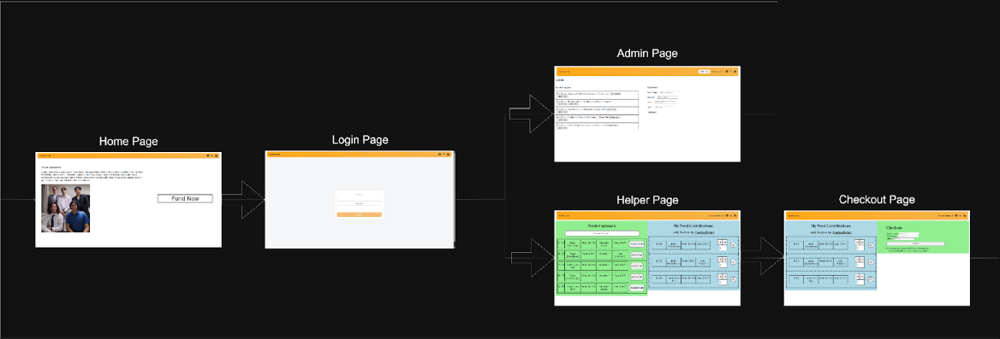

>>The primary flow is present on the Need Page and Checkout Page:
>The Need Page has a split layout where the left panel lists all available needs in the “need cupboard,” and the right panel shows the user’s current “funding basket.” Users can add items from the cupboard to their basket and adjust their quantities.

>Proceeding to the Checkout Page, the user sees a similar layout with basket contents on the left and payment inputs on the right.
>Filling out the payment fields and clicking checkout submits the purchase which makes the system remove the purchased quantities from the need cupboard, clears the user’s basket.

>>The admin flow is as follows:
>If a user logs in with the username “admin,” they’re taken to the Admin Page, which has a similar split layout with the left side displaying the current contents of the need cupboard, while the right side provides fields to add, update, or remove needs. 
>In addition, in the bottom right corner the current list of users are displayed. Here, the admin can delete specified users.

>Additional elements:
> In the home-page, any logged-in user will see a section dedicated to showcasing two randomly selected reviews. Underneath, there is a button to re-select two random reviews

> When logged in, any user can navigate to the reviews page from the navigation bar. Here, non-admins have a field to create a review given the rating and description. Admins have the ability to delete any individual review. 

### View Tier
> _**[Sprint 4]** Provide a summary of the View Tier UI of your architecture.
> Describe the types of components in the tier and describe their
> responsibilities.  This should be a narrative description, i.e. it has
> a flow or "story line" that the reader can follow._

> _**[Sprint 4]** You must  provide at least **2 sequence diagrams** as is relevant to a particular aspects 
> of the design that you are describing.  (**For example**, in a shopping experience application you might create a 
> sequence diagram of a customer searching for an item and adding to their cart.)
> As these can span multiple tiers, be sure to include an relevant HTTP requests from the client-side to the server-side 
> to help illustrate the end-to-end flow._

> _**[Sprint 4]** To adequately show your system, you will need to present the **class diagrams** where relevant in your design. Some additional tips:_
 >* _Class diagrams only apply to the **ViewModel** and **Model** Tier_
>* _A single class diagram of the entire system will not be effective. You may start with one, but will be need to break it down into smaller sections to account for requirements of each of the Tier static models below._
 >* _Correct labeling of relationships with proper notation for the relationship type, multiplicities, and navigation information will be important._
 >* _Include other details such as attributes and method signatures that you think are needed to support the level of detail in your discussion._

### ViewModel Tier

* NeedsCupboardController.java - Handles HTTP requests from the model tier for the Needs cupboard. 
  * getNeed()
      * Handles HTTP GET requests to the "/needs/id"
      * @param id: the searched objects id
      * @return a Response entity containing HttpStatus.OK if the search was successful,
      * a HttpStatus.NO_CONTENT if the returned data is null
      *  HttpStatus.INTERNAL_SERVER_ERROR if an I/O error occurred.
      * Retrieves a specified need given an id.
  * getNeeds()
      * Handles HTTP GET requests to the "/needs"
      * @return a Response entity containing HttpStatus.OK if the array of needs is returned,
      * a HttpStatus.NO_CONTENT if the return fails
      * HttpStatus.INTERNAL_SERVER_ERROR if an I/O error occurred.
      * Retrieves all needs in the NeedCupboard
  * searchNeeds()
      * Handles HTTP GET requests to the "/needs/?name= "name""
      * @param name , check if need contains String name
      * @return a Response entity containing HttpStatus.OK if the search was successful,
      * HttpStatus.INTERNAL_SERVER_ERROR if an I/O error occurred.
      * Searches for needs containing the given text
  * createNeed()
      * Handles HTTP POST requests to the "/needs"
      * @param need: the object to be created
      * @return a Response entity containing HttpStatus.CREATED if the creation was successful,
      * a HttpStatus.CONFLICT if the creation fails due to a conflict, or a HttpStatus.INTERNAL_SERVER_ERROR
      * if an I/O error occurred.
      * Creates a need given its (name, value, quantity, and type). An id is automatically generated. 
  * updateNeed()
      * Handles HTTP PUT requests to the "/needs"
      * @param need: the object to be updated
      * @return a Response entity containing HttpStatus.OK if the update was successful,
      * a HttpStatus.NOT_FOUND if need doesn't exist
      * HttpStatus.INTERNAL_SERVER_ERROR if an I/O error occurred.
      * Updates a need given its (id, name, value, quantity, and type). It will update the data at the specified id.
  * updateNeedVisibility()
      * Handles HTTP PUT requests to the "/needs/visibile/"visible""
      * @param userName: the user to update
      * @param id: the id of the need to be updated
      * @param visible: the visibility state to set the need
      * @return a Response entity containing HttpStatus.OK if the update was successful,
      * a HttpStatus.NOT_FOUND if need doesn't exist
      * HttpStatus.INTERNAL_SERVER_ERROR if an I/O error occured.
      * Updates a need's (visibile) attribute to true/false
  * deleteNeed()
      * Handles HTTP DELETE requests to the "/needs"
      * @param id , id of need to be deleted
      * @return a Response entity containing HttpStatus.OK if the deletion was successful,
      * a HttpStatus.NOT_FOUND if a need of id doesn't exist
      * HttpStatus.INTERNAL_SERVER_ERROR if an I/O error occurred.
      * Deletes a need given its id. 
  * deleteNeedType()
      * Handles HTTP DELETE requests to the "/needs"
      * @param type , type of need to be deleted
      * @return a Response entity containing HttpStatus.OK if the deletionn was successful,
      * a HttpStatus.NOT_FOUND if a need of id doesn't exist
      * HttpStatus.INTERNAL_SERVER_ERROR if an I/O error occured. 
      * Deletes a need given it contains the given type.
  * deleteAll()
      * Handles HTTP DELETE requests to the "/needs"
      * @return a Response entity containing HttpStatus.OK if the deletionn was successful,
      * a HttpStatus.NOT_FOUND if a need of id doesn't exist
      * HttpStatus.INTERNAL_SERVER_ERROR if an I/O error occured.
      * Deletes all needs in the Cupboard. 
  * deleteNeedName()
      * Handles HTTP DELETE requests to the "/needs"
      * @param name , string to check if name contains
      * @return a Response entity containing HttpStatus.OK if the deletion was successful,
      * a HttpStatus.NOT_FOUND if a need of id doesn't exist
      * HttpStatus.INTERNAL_SERVER_ERROR if an I/O error occured. 
      * Deletes needs given it contains the specified name.
    
* FundingBasketController.java - Handles HTTP requests from the model tier for the Funding Basket.
  * getUsers()
      * Handles HTTP GET requests to "/funding_basket_needs/users"
      * @return a Response entity containing HttpStatus.OK if the array of users is returned,
      * a HttpStatus.NO_CONTENT if the returned data is null
      * HttpStatus.INTERNAL_SERVER_ERROR if an I/O error occured.
  * getUsernames()
      * Handles HTTP GET requests to "/funding_basket_needs/usernames"
      * @return a Response entity containing HttpStatus.OK if the array of users is returned,
      * a HttpStatus.NO_CONTENT if the returned data is null
      * HttpStatus.INTERNAL_SERVER_ERROR if an I/O error occured. 
  * getNeed()
      * Handles HTTP GET requests to "/funding_basket_needs/userName/id"
      * @param userName: the user to search in
      * @param id: the searched objects id
      * @return a Response entity containing HttpStatus.OK if the search was successful,
      * a HttpStatus.NOT_FOUND if the search fails due to a non existent id
      *  HttpStatus.INTERNAL_SERVER_ERROR if an I/O error occured. 
  * getNeeds()
      * Handles HTTP GET requests to "/funding_basket_needs/userName/needs"
      * @param userName: the user to retrieve from
      * @return a Response entity containing HttpStatus.OK if the array of needs is returned,
      * a HttpStatus.NO_CONTENT if the returned data is null
      * HttpStatus.INTERNAL_SERVER_ERROR if an I/O error occured. 
  * searchNeeds()
      * Handles HTTP GET requests to "/funding_basket_needs/userName/?name= "name""
      * @param userName: the user to search from
      * @param name , check if need contains String name
      * @return a Response entity containing HttpStatus.OK if the search was successful,
      * HttpStatus.INTERNAL_SERVER_ERROR if an I/O error occured. 
  * createNeed()
      * Handles HTTP POST requests to "/funding_basket_needs/userName "need""
      * @param userName: the user to create in
      * @param need: the object to be created
      * @return a Response entity containing HttpStatus.CREATED if the creation was successful,
      * a HttpStatus.CONFLICT if the creation fails due to a conflict, or a HttpStatus.INTERNAL_SERVER_ERROR
      * if an I/O error occured. 
  * updateNeed()
      * Handles HTTP PUT requests to "/funding_basket_needs/userName "need""
      * @param userName: the user to update
      * @param need: the object to be updated
      * @return a Response entity containing HttpStatus.OK if the update was successful,
      * a HttpStatus.NOT_FOUND if need doesn't exist
      * HttpStatus.INTERNAL_SERVER_ERROR if an I/O error occured. 
  * updateNeedVisibility()
      * Handles HTTP PUT requests to "/funding_basket_needs/userName/id/visible/"visible""
      * @param userName: the user to update
      * @param id: the id of the need to be updated
      * @param visible: the visibility state to set the need
      * @return a Response entity containing HttpStatus.OK if the update was successful,
      * a HttpStatus.NOT_FOUND if need doesn't exist
      * HttpStatus.INTERNAL_SERVER_ERROR if an I/O error occured. 
  * deleteNeedId()
      * Handles HTTP DELETE requests to "/funding_basket_needs/userName/id"
      * @param userName: the user to delete from
      * @param id , id of need to be deleted
      * @return a Response entity containing HttpStatus.OK if the deletionn was successful,
      * a HttpStatus.NOT_FOUND if a need of id doesn't exist
      * HttpStatus.INTERNAL_SERVER_ERROR if an I/O error occured.
  * deleteNeedType()
      * Handles HTTP DELETE requests to "/funding_basket_needs/userName/type/type"
      * @param userName: the user to delete from
      * @param type , type of need to be deleted
      * @return a Response entity containing HttpStatus.OK if the deletionn was successful,
      * a HttpStatus.NOT_FOUND if a need of id doesn't exist
      * HttpStatus.INTERNAL_SERVER_ERROR if an I/O error occured. 
  * deleteAll()
      * Handles HTTP DELETE requests to "/funding_basket_needs/userName"
      * @param userName: the user to delete from
      * @return a Response entity containing HttpStatus.OK if the deletionn was successful,
      * a HttpStatus.NOT_FOUND if a need of id doesn't exist
      * HttpStatus.INTERNAL_SERVER_ERROR if an I/O error occured. 
  * deleteNeedName()
      * Handles HTTP DELETE requests to "/funding_basket_needs/name/"name""
      * @param userName: the user to delete from
      * @param name , string to check if name contains
      * @return a Response entity containing HttpStatus.OK if the deletionn was successful,
      * a HttpStatus.NOT_FOUND if a need of id doesn't exist
      * HttpStatus.INTERNAL_SERVER_ERROR if an I/O error occured.
   
* ReviewController.java - Handles HTTP requests for reviews
  * getReviews()
      * Handles HTTP GET requests to "/reviews"
      * @return a Response entity containing HttpStatus.OK if the array of reviews is successfully returned,
      * an HttpStatus.NO_CONTENT if there are no reviews
      * an HttpStatus.INTERNAL_SERVER_ERROR if an I/O error occured
  * getReviewsByRating()
      * Handles HTTP GET requests to "/reviews/rating/{rating}"
      * @param rating: the rating value the reviews are filtered by
      * @return a Response entity containing HttpStatus.OK if reviews with matching ratings are found
      * a HttpStatus.NO_CONTENT if no reviews match the rating parameter
      * HttpStatus.INTERNAL_SERVER_ERROR if an I/O error occurs
  * createReview()
      * Handles HTTP POST requests to "/reviews"
      * @param review: the Review object to be created
      * @return a Response entity containing HttpStatus.CREATED if the review is successfully created,
      * HttpStatus.CONFLICT if the creation failed,
      * HttpStatus.INTERNAL_SERVER_ERROR if an I/O error occured
  * deleteReview()
      * Handles HTTP DELETE requests to "/reviews/{id}"
      * @param id: the id of the review that is being deleted
      * @return a Response entity containing HttpStatus.OK if the review was deleted successfully,
      * HttpStatus.NOT_FOUND if there is no review with the given id
      * HttpStatus.INTERNAL_SERVER_ERROR if an I/O error occurred
  * deleteReviewsByUsername()
      * Handles HTTP DELETE requests to "/reviews/user/{userName}"
      * @param userName: the username of the user whose reviews should be deleted
      * @return a Response entity containing HttpStatus.ok if the review was deleted successfully,
      * HttpStatus.NOT_FOUND if there are no reviews from the given userName
      * HttpStatus.INTERNAL_SERVER_ERROR if an I/O error occurs
  * deleteAllReviews()
      * Handles HTTP DELETE requests to "/reviews"
      * @return a Response entity contatin HttpStatus.OK if all the reviews were deleted successfully,
      * HttpStatus.NOT_FOUND if there are no reviews
      * HttpStatus.INTERNAL_SERVER_ERROR if an I/O error occurs. 

> _**[Sprint 4]** Provide a summary of this tier of your architecture. This
> section will follow the same instructions that are given for the View
> Tier above._

> _At appropriate places as part of this narrative provide **one** or more updated and **properly labeled**
> static models (UML class diagrams) with some details such as associations (connections) between classes, and critical attributes and methods. (**Be sure** to revisit the Static **UML Review Sheet** to ensure your class diagrams are using correct format and syntax.)_
> 
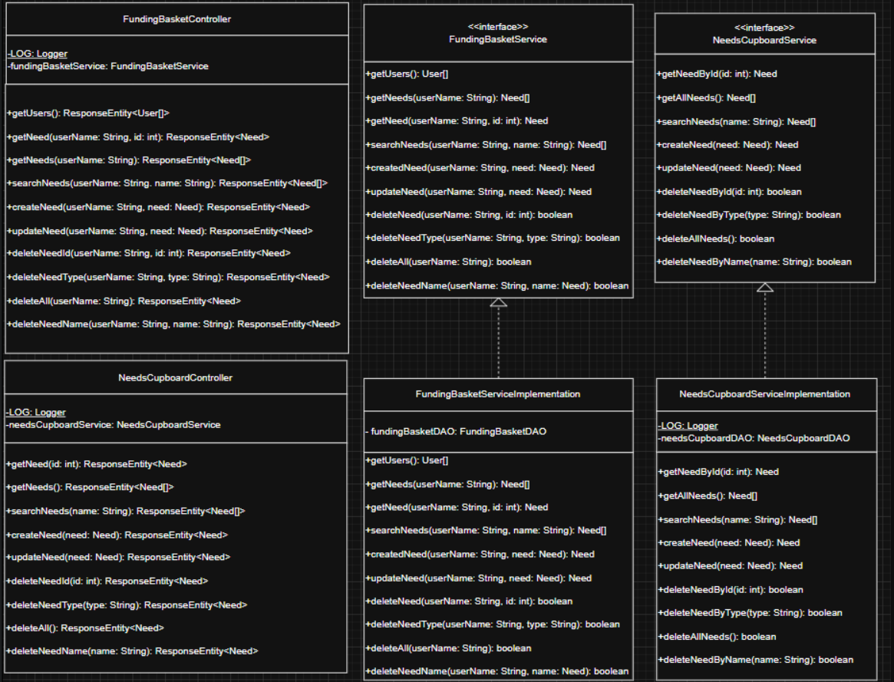

### Model Tier
>Our Model tier consists of a Need.java file that contains our need object. Each need object has an identification (id), name, value (or the cost), >type (what type of item it is), and quantity. There are getter and setters for each of the variables above.
>
>Our Model tier also includes a User.java file that represents an individual user. Each user has a name and a funding basket (an array of needs). >The class has a constructor to initialize these fields and getters (getName(), getBasket()).
>Finally, we also have a FundingBasketDataWrapper.java file that wraps the collection of users for persistence and transport. It holds a single >field, a list of users, along with a constructor to set it and a getter (getUsers()).
>
>Additionally, out Model tier contains a Review.java file that represents a review written by a user. Each review has a id, the username of the reviewer, the text content of the review, and an integer rating. The class includes a contains a constructor to initialze the various fields and getters for each field including: getId(), getUserName(), getReviewText(), and getRating().

  * Need.java - Create a Need object with given id, name, and value.
    * Contains getters (getID() -> int, getName() -> String, getValue() -> double, getQuantity() -> int, getType() -> String) and setters (setName(), setValue(), setQuantity(), setType()). Also contains a (toString() -> String) override.
    * This is used in NeedsCupboardFileDAO.java to hold data for a need/s.
  
  * FundingBasketDataWrapper.java - Create a Data Wrapper object with a given list of users (List<User>).
    * Contains (getUsers() -> List<User>) that returns the list of users.
    * The DataWrapper is used in FundingBasketFileDAO.java to wrap the data taken from funding_basket.json into a list of Users for proccessing by the application, and then later setting data proccessed by the application to the .json file.
  * User.java - Create a User object with a given name and basket(list of needs)
    * Contains getters (getName() -> String, getNeeds() -> Need[]) and a (toString() -> String) override.
    * This is used in FundingBasketFileDAO.java to hold data for a user/s.

  * NeedCupboardFileDAO.java - the working logic behind our application for accessing the Needs Cupboard. 
    * getNeedsArray()
      * @param text, if this string is passed in only add needs contaiting to Array
      * @return Array of Needs
      * Creates array of Needs from tree map for needs that contain "text".
      * if "text" is null, array will contain all needs in the treemap.
    * save()
      * Saves Needs from map into file
      *@return true, if written successfully
    * load()
      * Load from JSON into the map
      * Increment id after all have been read in
      * @return true if read successfully
    * getNeeds()
      * @return getNeedsArray
      * Returns an array of all needs in the JSON.
    * searchNeeds()
      * Search for needs containing text passed in
      * @param String text
      * @return getNeedsArray that contains text
    * getNeed()
      * Returns single need with id
      * @param int id id to search for 
      * @return need if found, null if no id in needs JSON
    * createNeed()
      * @param need: the input object containing the name, value, quantity, and type
      * @return the new need with a generated id
      * @throws I/O exception if an error occured while saving the new Need to storage
    * updateNeed()
      * Update need's contents, ie name, value, quantity, type
      * @param  Need need
      * @return Need updated need
    * deleteNeed()
      * Delete need at specified id
      * @param int id
      * @return true if file was updated succesfully
      * @return false, if deletion failed 
    * deleteNeedType()
      * Delete all needs of specific type
      * Seemed liike using a removeIf is the best way to do this 
      * since you cant iterate through a tree map and delete things without throwing error.
      * @param int id
      * @return true if file was updated succesfully
      * @return false, if deletion failed
    * deleteAll()
      * Delete all needs
      * @return true if file was updated succesfully
      * @return false, if deletion failed
    * deleteNeedName()
      * Delete all needs of specific name
      * @return true if file was updated succesfully
      * @return false, if deletion failed 

  * FundingBasketFileDAO.java - the working logic behind our application for accessing the Needs Cupboard. 
    * swapCurrentUser()
      * Swaps the current user to the specified userName, setting their respective data
      * @param userName the user that will be swapped to
      * @return
    * getUsersArray()
      *  Create array of Users from tree map
      * @return Array of Users, could be null 
    * getNeedsArray()
      *  Create array of Needs from tree map
      * @param userName the user this method will get the needs of
      * @return Array of Needs, could be null
    * save()
      * Saves Needs from map into file
      *@return true, if written successfully
    * load()
      * Load from JSON into the map
      * Increment through every user, adding their name and their funding basket to the TreeMap
      * @return true if read successfully
    * getUsers()
      * Returns array of all users
      * @return getNeedsArray
    * getNeeds()
      * Returns array of all needs for a specified user
      * @param userName the user this method will modify
      * @return getNeedsArray 
    * searchNeeds()
      * Search for needs containing text passed in
      * @param userName the user this method will modify
      * @param String text
      * @return getNeedsArray that contains text 
    * getNeed()
      * Returns single need with id
      * @param userName the user this method will modify
      * @param int id id to search for 
      * @return need if found, null if no id in needs JSON 
    * createNeed()
      * Creates a new Need object and a new User if one was not present
      * @param userName: the name of the user the new need belongs to
      * @param need: the input object containing the id, name, value, quantity, and type
      * @return the new need
      * @throws I/O exception if an error occured while saving the new Need to storage
    * updateNeed()
      * Update need's contents, ie name, value, quantity, type
      * @param userName the user this method will modify
      * @param  Need need
      * @return Need updated need
    * deleteNeed()
      * Delete need at specified id
      * @param userName the user this method will modify
      * @param int id
      * @return true if file was updated succesfully
      * @return false, if deletion failed
    * deleteNeedType()
      * Delete all needs of specific type
      * Seemed liike using a removeIf is the best way to do this 
      * since you cant iterate through a tree map and delete things without throwing error.
      * @param userName the user this method will modify
      * @param string type
      * @return true if file was updated succesfully
      * @return false, if deletion failed 
    * deleteAll()
      * Delete all needs
      * @param userName the user this method will modify
      * @return true if file was updated succesfully
      * @return false, if deletion failed 
    * deleteNeedName()
      * Delete all needs of specific name
      * @param userName the user this method will modify
      * @return true if file was updated succesfully
      * @return false, if deletion failed
        
  * Review.java
    * Creates a Review object using an id, userName, reviewText, and rating and parameters
    * Contains getters (getId() -> int, getUserName() -> String, getReviewText() -> String, getRating() -> int) as well as a (toString() -> String) override
    * This is used in ReviewFileDAO.java to hold data for reviews.
  
  * ReviewFileDAO.java - the working logic behind our application for accessing Reviews.
    * getReviews()
      * Loads all of the reviews from the persistance storage
      * @return an array of all reviews stored in the JSON file
    * getReviewsByRating
      * Filters the list of reviews to only show those that have the same rating as specified
      * @param int rating: the rating value to filter with
      * @return an array of reviews with the same rating as the parameter
    * createReview()
      * Adds a new review into the JSON file and assigns it a unique id.
      * @param Review review: the review object that is being added
      * @return the new Review now with an id
      * @throws I/O exception if an error ocurred
    * deleteReview()
      * Removes a review from the JSON based on its id
      * @param int id: the id of the review to delete
      * @return true if the review was deleted successfully or false if it was not
    * deleteReviewByUsername()
      * Removes all reviews from a specific user from the JSON
      * @param String userName: the username of the user whose reviews should be deleted
      * @return true if the review was deleted successfully or false if it was not
    * deleteAll()
      * Deletes all the reviews from the persistance storage
      * @return true if the file was updated successfully or false if it failed
    * save()
      * Write the current list of reviews into the JSON file
      * @return true if it was written successfully or false if it was not
    * load()
      * Loads all the reviews from the JSON file into the memory
      * @return true if it read successfully

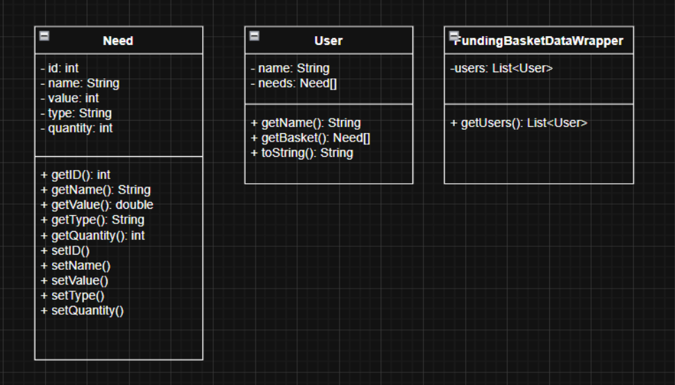

## OO Design Principles
Sprint 1: The two Object Oriented Design principles that the CTRL team is championing throughout the design and implementation are Low Coupling and Open/Close. The Low Coupling principle is aimed towards minimizing interdependence between different classes.  One example of Low Coupling in our project can be shown through our Need and User model classes. 

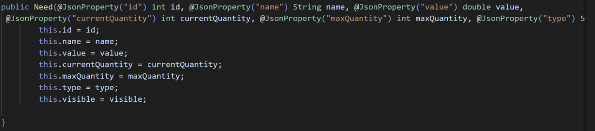

The need class only takes in primitive types as variables, which means that it has no reliance on other classes allowing it to follow the Low Coupling principle. The user class does take an array of needs as one of its variables, however, it is not dependent on the actual internal functions of the need class. This enables changes to be made to need without causing any problems with the User class. The open/closed object oriented principle states that software entities should be open for extension but closed for modification. One way this was utilized throughout the project was through the use of interfaces in the persistence tier. A specific example of this is shown below through NeedsCupboardDAO and NeedsCupboardFileDAO. 

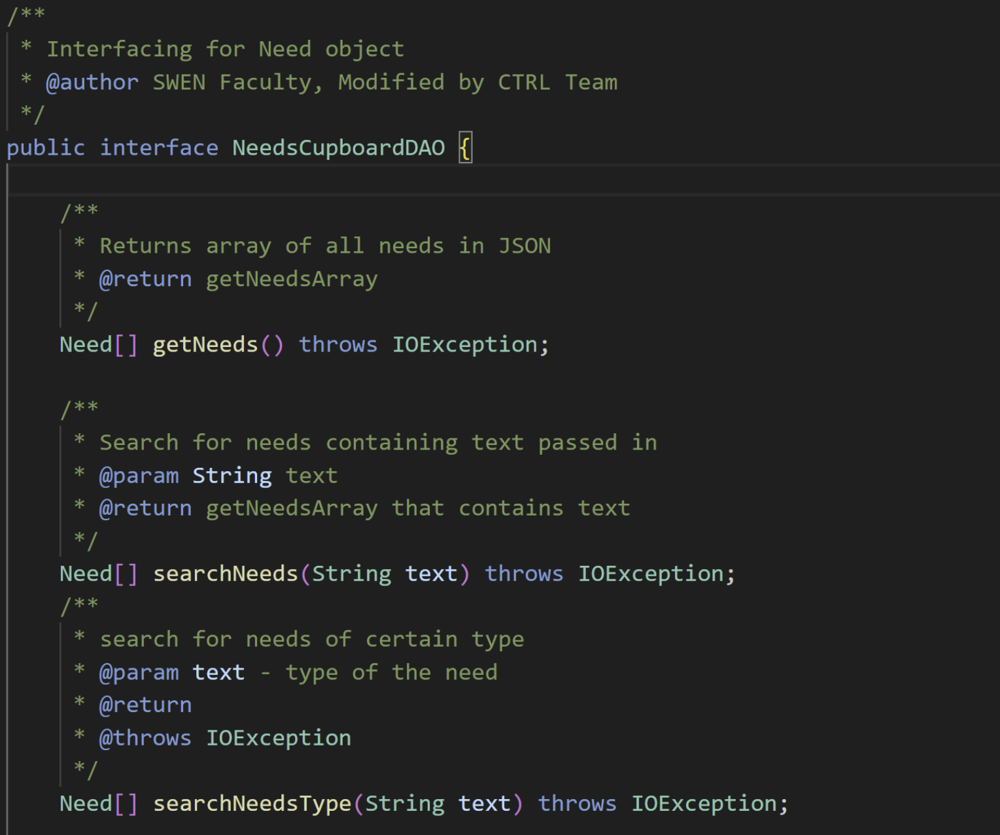
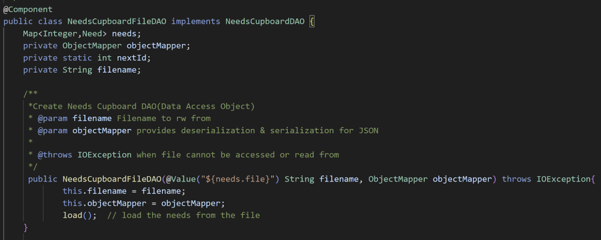

As a result of the persistence tier being designed this way, if something such as how the data is stored is modified, the rest of the system will remain unaffected following the open/closed principle. 

Sprint 2: The two Object Oriented Design principles that the CTRL team is championing throughout Sprint 2 are the Law of Demeter and Pure Fabrication. The Law of Demeter principle is being followed through our implementation of service classes, which serves as an inbetween for the controller and DAO. This prevents the classes from having to call other classes that are distant which would break the “don’t talk to strangers” principle for the Law of Demeter. This can be shown through NeedsCupboardServiceImplementation and how it only talks to its DAO. 

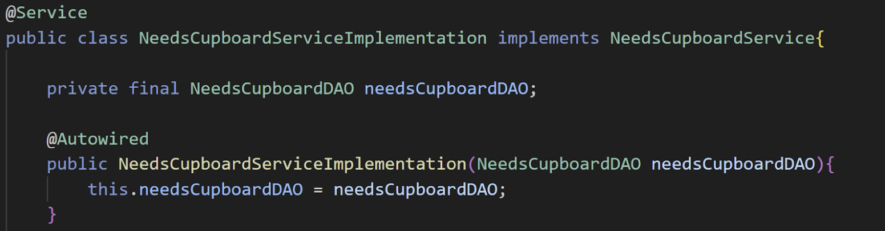

Another principle that the service files helped us follow was Pure Fabrication. Pure Fabrication is when a new class is created to handle responsibilities that don’t fit well with the already existing classes. The service files were created to specifically handle the communication between the controller and DAO, making it a good example of following the Pure Fabrication principle. The searchNeedsType method in the NeedsCupboardServiceImplementation shows how the class functions as a middleman between the DAO and the controller, following the Pure Fabrication Principle. 

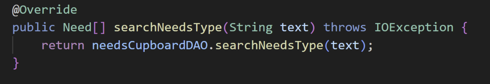

Sprint 3: The Object Oriented Design Principle that the CTRL team decided to champion throughout sprint 3 was Single Responsibility. The Single Responsibility principle is the idea that each class should have a single tightly focused responsibility. One way this principle was implemented throughout the project during sprint 3 was through the review system, where each class has its own specific purpose. In the model tier, the review model serves to define the structure of the reviews data. This can be seen through the constructor in the review model. 

In the persistence tier, ReviewFileDAO handles the storage and retrieval of data for Reviews. Two methods that play a huge role in the storage and retrieval of data for Reviews are save() and load() methods that are shown below.

The ReviewServiceImplementation file handles all communications between the Review Controller and the Review Persistence tiers. This communication to the ReviewDAO can be seen in the code snippet below from ReviewServiceImplementation. 

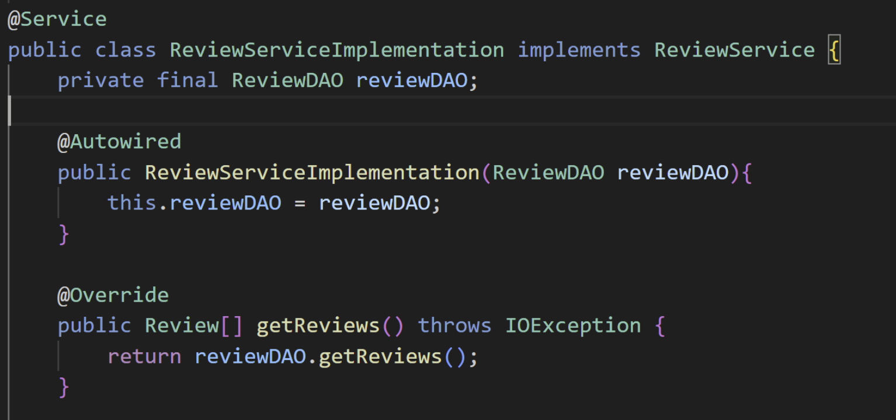

Finally, the Review Controller handles all REST API requests for reviews. For example, the code below shows how the Review Controller handles the request for creating a new review.
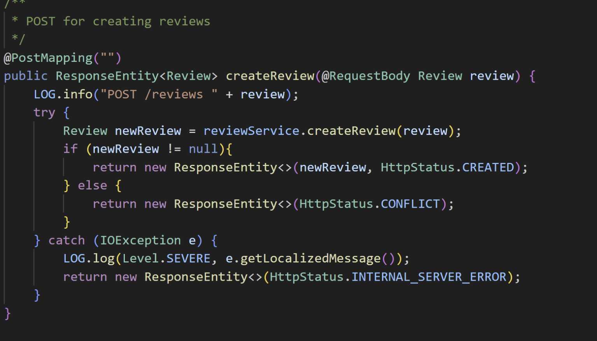
>
> _**[Sprint 4]** OO Design Principles should span across **all tiers.**_

## Static Code Analysis/Future Design Improvements
> _**[Sprint 4]** With the results from the Static Code Analysis exercise, 
> **Identify 3-4** areas within your code that have been flagged by the Static Code 
> Analysis Tool (SonarQube) and provide your analysis and recommendations.  
> Include any relevant screenshot(s) with each area._

> _**[Sprint 4]** Discuss **future** refactoring and other design improvements your team would explore if the team had additional time._

## Testing
### Acceptance Testing
>Across Sprints 2, acceptance testing indicates that the majority of user stories have fully met their acceptance criteria. Core user flows are >behaving as expected like the persistent navigation bar correctly routes to myResearch (Homepage), Login, and Checkout; the Login Page accurately >authenticates valid users and their roles; and the needs list currently sending data to the funding basket. One acceptance criteria failure (which >was later resolved) was where the wrong user’s funding basket appeared after login. Another acceptance criteria failure that was fixed was the ?>Update Need feature on the Admin Page which attempts to modify an existing need, currently reset fields to empty or zero and does not save ?>updates. Other than that, all other tested stories passed without exception. 

### Unit Testing and Code Coverage
> _**[Sprint 4]** Discuss your unit testing strategy. Report on the code coverage
> achieved from unit testing of the code base. Discuss the team's
> coverage targets, why you selected those values, and how well your
> code coverage met your targets._

>_**[Sprint 2, 3 & 4]** **Include images of your code coverage report.** If there are any anomalies, discuss
> those._W
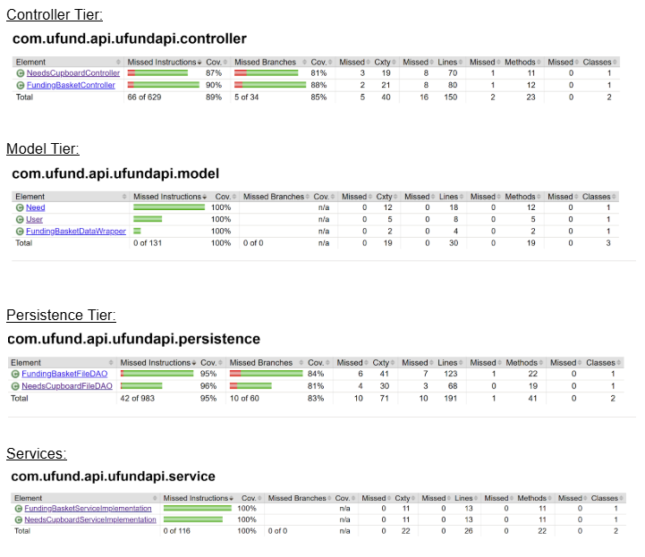

## Ongoing Rationale
>_**[Sprint 1, 2, 3 & 4]** Throughout the project, provide a time stamp **(yyyy/mm/dd): Sprint # and description** of any _**mayor**_ team decisions or design milestones/changes and corresponding justification._

* Sprint #1:
* 2025/09/10
  * Revised our Sprint 1 Domain Model with additional information on any “flavoring” we intend on adding.
  * Chose our project topic - “Research Funding : Name : RIT Student Funding Research”
* 2025/09/13
  * Trello updates that enforce our Sprint 1 Planning decisions and guidelines including: making a new list containing our plans in code communications, team communications, version control activities, and more. 
  * Also began initial drafts on acceptance criteria for each of our user stories.
* 2025/09/17
  * Assign OO Design Principles to each group member and champion two of them.
  * Understand how each user story can be implemented and coded as well as a general understanding of our project’s architecture. 
  * This includes beginning our draft of solution tasks for each user story.
* 2025/09/20
  * Finalize solution tasks and anything inside our user story cards.
  * Designed a UML of our classes and project structure to enforce our understanding of our project.
* 2025/09/24
  * Make sure each group member has an understanding of how our github works and begin coding each of our user stories.
* 2025/09/27-28
  * Finalize our Sprint 1 coding and make sure it adheres to our user story. 
  * Ensuring each member has their code properly working before merging all of it.
  * Record our demo video and our scripts.
  * Finish all Sprint 1 requirements in the Design Doc. 
 
* Sprint #2:

* 2025/10/01
  * Wrote our beginning sprint 2 epics and user stories
    * Assigned points to them with Planning Poker
    * Acceptance Test Plan updated with them
* 2025/10/04-05
  * Unit test verifications for MVC
    * Making sure they all ran + worked
  * Created our first angular files
    * Gave us a good baseline to work on
    * Split the stories among team members to work individually so we can test angular in our own playgrounds.
* 2025/10/08
  * Merged all our separate branches into main to create a beginning working UI (no functionality, just page routing)
  * Also added a navigation bar
* 2025/10/09
  * Completed code coverage of the unit tests we had
  * Assigned tasks of each of our user stories to begin having a UI with functionality
* 2025/10/13
  * Quick agenda and progress check on all our code.
  * Code reviewed one of our codes.

* 2025/10/18-19
  * Planned the our agenda for the rest of Spring 2 (establishing deadlines and work)
  * Began merging our almost final codes.
  * TODO : Currently have hardcoded that any password passes for users, this will be updated during sprint 3 if necessary.

